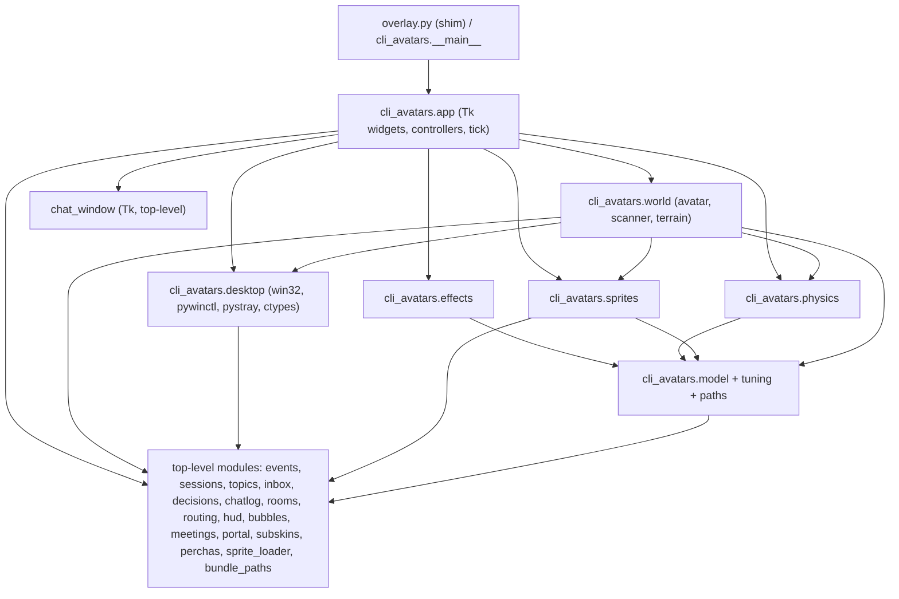

# Architecture: splitting overlay.py

Task: SPLIT.1. Design for SPLIT.2 to SPLIT.5. No code moves in this task.

Goal: turn the 3,636-line `overlay.py` into a nested package `cli_avatars/`
without changing behaviour, so feature work (most of it by Agents after
SPLIT.4) has a clear place to go.

Line numbers below are from `dev` at `5d0edad` (23/11/2026). They will drift;
use the names, not the numbers, once SPLIT.2 starts.

---

## 1. Current state

### 1.1 Size

| File | Lines | Notes |
|------|------:|-------|
| `overlay.py` | 3,636 | 1 module, 9 classes, 1 class (`OverlayApp`) of ~2,180 lines |
| `OverlayApp._tick` | ~300 | one method runs every frame |
| Other top-level modules | ~12,400 | already split, mostly Tk-free |

### 1.2 Map of overlay.py

**Module level**

| Lines | Name(s) | Responsibility | Depends on |
|------:|---------|----------------|------------|
| 1–107 | docstring, imports | 13 sibling modules imported by name | sessions, hud, rooms, events, decisions, topics, routing, subskins, chat_window, bubbles, meetings, portal, bundle_paths |
| 109 | `VERSION` | `"0.4"` (also hard-coded in HUD title and `run`) | — |
| 111–143 | optional deps | `HAS_WINCTL`, `HAS_W32`, `HAS_PIL`, `HAS_SPRITES`. **Calls `w32.set_dpi_aware()` at import**, before any `tk.Tk()` | pywinctl, win32, perchas, PIL, sprite_loader |
| 146–197 | config constants | FPS, scan rates, gravity, walk, spring, leash, wall climb, scale, colors, `SPRITES_DIR`, `REAL_SESSION_SKINS` | bundle_paths |
| 200–363 | `_extract_bubble_sheet`, `_extract_caine_sheet`, `_extract_amongo_sheet` | **Sheet loading**: build PNGs from source art in `../Images/` (outside the repo) when missing | PIL |
| 366–411 | `REGISTRY`, `_load_sprites` | **Sheet loading**: global `SpriteRegistry`, load the built-in sheet list and `Sprites/subagents/` | sprite_loader |
| 414–426 | `_is_subagent_sheet`, `subagent_sprite_mode` | fly/ground lookup on `REGISTRY` | REGISTRY |
| 429–487 | `_startup_report` | console diagnostics. **Unused** | REGISTRY private fields |
| 490–526 | `S`, `STATUS_COLOR`, `AgentInfo` | agent status names, colors, dataclass | — |
| 529–576 | `_WALK_A/_WALK_B`, `_parse_sprite`, `make_photo` | **Sheet loading** (fallback): procedural 8×8 sprite → `ImageTk.PhotoImage` | PIL, ImageTk |
| 579–671 | `Particle`, `BurstEffect`, `GlitchFlash` | **Effects**: canvas particles and drag/right-click glitch | a canvas (duck-typed) |
| 674–706 | `_sample_sprite_colors` | **Effects**: palette for the vanish burst | REGISTRY private fields |
| 709–985 | `Avatar` | **Avatar**: gravity, floor catch, walk AI, wall climb, meeting steer, animation, `draw(canvas)` | constants, `S`, `child_flight_mode`, `make_photo`, registry |
| 988–1147 | `SessionScanner` | **SessionScanner**: polls sources, owns `EventBus`, `BubbleBoard`, `MeetingBoard`, UDP `EventSource`; psutil pid match; skin cycling | sessions, events, bubbles, meetings, rooms, `AgentInfo`, `S` |
| 1150–1246 | `WindowTerrain` | **WindowTerrain**: floors/walls from win32 (DWM perches) or pywinctl fallback | win32, perchas, pywinctl |
| 1249–1255 | `_alpha_stipple` | Tk stipple name for an alpha | — |
| 1262–1270 | `_hud_status_text` | HUD rows | hud |
| 1273–1344 | `_spring_frame`, `_clamp_span`, `leash_px_from_config`, `child_flight_mode`, `elastic_endpoints`, `_clamp_speed` | **Spring/leash physics** helpers (pure) | constants, `subagent_sprite_mode` |
| 1347–3530 | `OverlayApp` | everything else (below) | all of the above |
| 3533–3623 | `run_selftest` | off-screen HUD + chat window check | Tk, `OverlayApp.__new__`, chat_window |
| 3626–3636 | `main`, `__main__` | `--selftest` or run the app | — |

**OverlayApp, by controller**

| Lines | Methods | Future controller |
|------:|---------|-------------------|
| 1354–1447 | `__init__`, `_deferred_init` | app shell: Tk root, full-screen canvas, chroma key, 3 daemon threads, bindings |
| 1451–1750 | `_tick` | **tick loop** (see 1.3) |
| 1752–1798 | `_refresh_activity`, `_meeting_stage` | avatar pool / meetings |
| 1802–1803 | `color_for` | render |
| 1805–1876 | `_drive_subagent`, `_begin_dying`, `_release_finished_dying` | **subagent** |
| 1878–2035 | `_end_spring` (unused), `_apply_spring`, `_apply_fly_spring`, `_subagent_skin_pool`, `_leash_px`, `_constrain_leash` | **spring/leash physics** (mutates avatars, no Tk) |
| 2037–2073 | `_draw_elastic` | render (zigzag line) |
| 2077–2270 | `_load_bubble_icon`, `_bring_all_to_front`, `_setup_tray`, `_show_hud_win`, `_create_hud_win` | **HUD/menu** (+ pystray tray) |
| 2272–2296 | `_draw_portal` | **portal** |
| 2298–2371 | `_draw_talk_bubbles`, `_draw_decision_bubbles` | render (bubbles) |
| 2373–2424 | `_paint_hud_rows`, `_update_hud_win` | **HUD/menu** |
| 2428–2795 | `_remember_rooms` … `_render_orchestrator_dot` (22 methods) | **chat/topics** (rooms + topics panel) |
| 2799–2886 | `_chat_directory` … `_open_chat_for_avatar` (9 methods) | **chat/topics** (chat window) |
| 2890–2970 | `_avatar_at`, `_on_left_*`, `_on_double_click`, `_quit`, `_on_right_click` | **input** |
| 2972–3058 | `_focus_console` (unused), `_focus_linked_console` | platform (Windows ctypes, psutil) |
| 3060–3345 | `PICK*`, `_open_skin_picker`, `_picker_sheet`, `_picker_frame`, `_build_picker_ui`, `_apply_skin` | **HUD/menu** (skin picker) |
| 3349–3525 | `_open_config_screen`, `_build_config_ui` | **HUD/menu** (config screen) |
| 3527–3530 | `run` | app shell |

### 1.3 The tick loop (`_tick`, 1451–1750)

One call per frame at `OVERLAY_FPS` via `root.after`. Order matters; keep it.

1. Snapshot agents (scanner) and terrain (floors, walls, hwnds, window positions).
2. Sync the main avatar pool: remove gone agents, create new `Avatar`s.
3. Ride window moves (`perchas.window_moves`) for avatars on a perch.
4. Meeting plan: `meetings.step(stage)` → steers.
5. Main avatars: vanish after 5 min idle (float + burst), else `update` and `draw`.
6. Delete and redraw floor lines (`FLOOR_LINE_ALPHA > 0`).
7. Subagents per parent: trim, dismissed credit, spawn (skin chosen once), float-away after 10 min, meeting follow or `_drive_subagent`, draw, elastic lines.
8. Lingering subagents (float away 30 s after task done).
9. Dying subagents (`_release_finished_dying`).
10. Bursts and glitches.
11. Portal, talk bubbles, decision bubbles.
12. HUD, rooms panel, chat panel refresh (each guarded by `try/except` + logging).
13. Schedule the next tick.

Cost today: every frame re-creates canvas items for floor lines, elastic
lines, portal and bubbles (`delete(tag)` then `create_*`), calls
`registry.get_photo` per avatar, and reads the decisions store twice
(`open_agent_ids`, `open_count`) plus topics/rooms while panels are open.

### 1.4 Global state

| State | Where | Problem for the split |
|-------|-------|-----------------------|
| `REGISTRY` | module singleton (370) | read by `Avatar`, picker, effects, subagents. Must stay one object |
| Tunables `GRAVITY`, `WALK_SPEED`, `JUMP_VEL`, `SPRING_*`, `OVERLAY_FPS`, `SESSION_SCAN_RATE`, `WINDOW_SCAN_RATE`, `TEST_SUBAGENTS`, `AVATAR_SCALE`, `FLOOR_LINE_ALPHA`, `OVERLAY_ALPHA` | module globals, **rewritten with `global` by the config screen** (3427, 3454, 3458, 3506) | `from x import GRAVITY` copies the value. After a move, Apply would stop affecting physics |
| `HAS_*` flags | import time | fine as module constants |
| DPI awareness | side effect at import (126) | must still run before the first `tk.Tk()` |
| Tk images | `self._photo`, `_portal_cache`, `_talk_cache`, `_decision_photo`, `_rooms_thumbs`, picker `cache` | must outlive the canvas item or Tk blanks it |
| Late attributes | `_prev_subagent_counts`, `_talk_cache`, `_seeded`, `_fly_phase`, `_sub_mode`, … via `getattr`/`hasattr` | tests build `OverlayApp.__new__` and `Avatar` without `__init__`; controllers must tolerate missing fields the same way |
| Paths from `__file__` | `config.json` (1355), `../Images/` (225, 280, 333, 1377, 2118) | a file moved into `cli_avatars/app/` would look in the wrong folder |

### 1.5 Tk coupling

- `tkinter` is imported at the top, so `import overlay` needs a display.
  That is why `tests/test_spring.py` runs `tests/spring_physics.py` in a child process.
- Tk-free today, despite living in overlay.py: config constants, `S`,
  `AgentInfo`, spring/leash helpers and methods, `SessionScanner`,
  `WindowTerrain`, sheet extractors (PIL only), `Avatar.update`.
- Duck-typed canvas (no `tk` name): `Avatar.draw`, `BurstEffect`, `GlitchFlash`.
- Needs `ImageTk`: `make_photo`, every bubble/portal/thumbnail cache.
- Needs `tk` widgets: HUD, rooms/topics, chat glue, picker, config, selftest.

### 1.6 Known quirks to keep (not fix) during SPLIT

- `STATUS_COLOR` from `topics` is imported (90) and then **shadowed** by the
  agent `STATUS_COLOR` (502). `_render_topic_card` therefore colors topic chips
  with the agent palette. Keep this in SPLIT; fix it in a separate `fix:` PR.
- `_startup_report`, `_focus_console`, `_end_spring`, `get_floors`,
  `get_walls` are unused. Move them as-is; delete in SPLIT.5 if still unused.
- `S` and the status strings are duplicated in `sessions.py`, `hud.py`,
  `rooms.py`, `events.STATE_VALUES`, `cli_avatars_emit._STATE_CHOICES`.
- `meetings.spring_points` and `_draw_elastic` both build the zigzag.
- `_load_sprites` and `_extract_*` read source art from `../Images/`, a
  sibling of the repo. On a clean clone they print a warning and skip.

---

## 2. Target package

The existing top-level modules (`events`, `sessions`, `topics`, `inbox`,
`decisions`, `chatlog`, `rooms`, `routing`, `hud`, `bubbles`, `meetings`,
`portal`, `subskins`, `perchas`, `win32`, `sprite_loader`, `bundle_paths`,
`chat_window`) **stay where they are** during SPLIT. `cli_avatars_emit`,
`cli_avatars_mcp`, hooks and 20 test files import them by top-level name.
Folding them into the package is out of scope.

```
cli_avatars/
  __init__.py          VERSION only. Imports nothing heavy.
  __main__.py          python -m cli_avatars → app.main.main()
  paths.py             repo/app root for config.json and dev art; replaces Path(__file__) lookups
  tuning.py            Tuning dataclass + TUNING singleton: every runtime-tunable constant
  model/
    agent.py           S (statuses), AGENT_STATUS_COLOR, AgentInfo
  sprites/
    extract.py         _extract_bubble/caine/amongo_sheet (PIL only)
    registry.py        REGISTRY singleton, load_sprites, subagent_sprite_mode, is_subagent_sheet, startup_report
    procedural.py      fallback 8x8 sprite as a PIL image (make_photo wraps it)
    palette.py         sample_sprite_colors
  physics/
    spring.py          spring_frame, clamp_span, clamp_speed, apply_spring, apply_fly_spring
    leash.py           leash_px_from_config, constrain_leash
    geometry.py        child_flight_mode, elastic_endpoints, zigzag points
  effects/
    burst.py           Particle, BurstEffect
    glitch.py          GlitchFlash
  world/
    avatar.py          Avatar: physics step + draw onto a canvas-like object
    scanner.py         SessionScanner (bus, bubbles, meetings, UDP listener, pid match)
    terrain.py         WindowTerrain (calls desktop/ for window lists)
  desktop/
    capabilities.py    HAS_WINCTL / HAS_W32 / HAS_PIL probes; set_dpi_aware() called once, early
    windows.py         window list facade over win32 + perchas, pywinctl fallback
    focus.py           focus_linked_console, focus_console (ctypes, psutil)
    tray.py            pystray icon and menu (callbacks injected)
  app/
    main.py            main(argv), run_selftest
    shell.py           OverlayApp: Tk root, canvas, threads, controller wiring, run, quit
    tick.py            TickLoop: the 13-step frame order from 1.3
    pool.py            main avatar pool sync, window ride, vanish, meeting stage
    subagents.py       spawn/trim/dismiss, float-away, linger, dying, drive (calls physics/)
    render.py          floor lines, elastic lines, PhotoCache, dirty redraw (SPLIT.5)
    bubbles_view.py    talk + decision bubbles on the canvas
    portal_view.py     portal on the meeting surface
    input.py           press/drag/release/double/right click, avatar_at, throw
    hud_window.py      HUD window, status rows, bubble icon
    rooms_panel.py     rooms + topics panel
    chat.py            ChatWindow glue: open/toggle/close, open for avatar, chat box
    skin_picker.py     character select window
    config_screen.py   config window (writes TUNING, not globals)
```

Name choices:

- `desktop/`, not `platform/`: a subpackage called `platform` reads like the
  stdlib module and confuses tools and PyInstaller hook lookup.
- `hud_window`, `portal_view`, `bubbles_view`: avoid two files called `hud.py`,
  `portal.py`, `bubbles.py` in one traceback.
- `model/` is where pure data lives: it is the home for CHAT-TREE and `blocked` (section 6).

---

## 3. Import rules

### 3.1 Layers



### 3.2 Rules

1. An arrow is the only allowed direction. Nothing imports `app`. Nothing
   below `app` imports `world`. `physics`, `effects`, `sprites` do not
   import each other, except `physics.geometry` may import
   `sprites.registry.subagent_sprite_mode` (today's `child_flight_mode`
   needs it). Prefer passing the mode in.
2. **No `tkinter` import below `app/`.** `world`, `effects` take a canvas
   argument and only call its methods.
3. One documented exception until SPLIT.5: `sprites/procedural.make_photo`
   and `sprite_loader` import `PIL.ImageTk` **inside a function**. SPLIT.5
   moves PhotoImage creation into `app/render.PhotoCache` and removes it.
4. `desktop/` is the only package that touches `ctypes.windll`, `pywinctl`,
   `pystray`, or imports `win32`/`perchas`. Every import there is guarded so
   Linux and macOS still start.
5. `model/`, `tuning`, `physics/`, `sprites/extract`, `world/scanner`,
   `world/terrain` (with a fake window list) must import and run in a test
   with no display.
6. No import cycles. Import modules at the top; no function-level imports to
   dodge a cycle. A cycle means the code is in the wrong layer.
7. Top-level modules never import `cli_avatars` (they stay usable by
   `cli_avatars_emit`, MCP and hooks without Tk or PIL).
8. Tunables are read at call time: `from cli_avatars.tuning import TUNING`
   then `TUNING.gravity`. Never `from cli_avatars.tuning import GRAVITY`.
9. Process launching: see 6.1. Nothing under `cli_avatars/` imports
   `subprocess` except `runner/cli_runner.py`.

A test (`tests/test_layers.py`, added in SPLIT.2) parses each file with
`ast` and fails on a forbidden import. It does not import the package, so it
runs without Tk.

---

## 4. Shim plan

`overlay.py` stays at the repo root as a thin entry point:

```python
"""Entry point. Code lives in cli_avatars/. Kept for python overlay.py,
--selftest, the PyInstaller spec and old imports."""
from cli_avatars.app.main import main, run_selftest
from cli_avatars.tuning import TUNING
# ... re-exports listed below ...

if __name__ == "__main__":
    raise SystemExit(main())
```

The shim keeps working:

- `python overlay.py` and `python overlay.py --selftest` (README, AGENTS, `tests/test_selftest.py`).
- `cli-avatars.spec` still analyses `overlay.py`.
- `cli-avatars.exe --selftest` in `build.ps1`.

### 4.1 Names imported from overlay today

Only `tests/spring_physics.py` imports the module. No other module, hook or
tool does.

| Name | Kind | Re-export from |
|------|------|----------------|
| `FLY_BOB`, `GRAVITY`, `SPRING_DAMP`, `SPRING_K`, `SPRING_MAX_SPEED`, `SPRING_REST`, `SUBAGENT_LEASH_MAX`, `WALK_SPEED` | constants | `tuning` (module-level copies of the defaults) |
| `AgentInfo` | dataclass | `model.agent` |
| `Avatar` | class | `world.avatar` |
| `OverlayApp` | class | `app.shell` |
| `child_flight_mode`, `elastic_endpoints` | functions | `physics.geometry` |
| `leash_px_from_config` | function | `physics.leash` |
| `overlay` (module) | `import overlay`; no attribute used, the import must just succeed | the shim itself |

`spring_physics.py` also calls these `OverlayApp` methods on an instance made
with `OverlayApp.__new__`: `_drive_subagent`, `_apply_spring`,
`_constrain_leash`, `_begin_dying`, `_release_finished_dying`, and sets
`app.config`, `app.canvas`, `app.avatars`, `app._dying_subs`. And it calls
`inspect.getsource(OverlayApp._tick)` / `_drive_subagent` looking for the
strings `spring_mode=True`, `_drive_subagent`, `_apply_spring`,
`_begin_dying`, `_dying_subs`, `assign_subagent_skin(` (exactly once, after
`while len(sub_list)`), `_sub_mode`.

Plan: keep thin delegating methods on `OverlayApp` with the same names and
signatures through SPLIT.4. In SPLIT.4, update those source-inspection
asserts to point at the new controller (`SubagentController.step`) in the
same PR.

`run_selftest` builds `OverlayApp.__new__` and sets `root`, `_offscreen`,
`scanner`, `_rooms_shown`, `_chat_shown`, `_rooms_btn`, `_chat_btn`,
`_hud_drag_origin`, then calls `_create_hud_win`. It moves with the HUD in
SPLIT.4 and must still work with only those attributes.

### 4.2 Tests that read overlay.py as text

These grep the file, so they break as soon as code leaves it. Each SPLIT PR
that moves the matching code must repoint the test at the new file (or at a
small list of files) in the same PR.

| Test | Strings it needs | Moves in |
|------|------------------|----------|
| `test_grok_sessions` `test_source_text_does_not_name_secret_readers` | `grok_skin_id`, `ai.source == "grok"`, `TODO(Caine art)` | SPLIT.3 (`world/scanner.py`; `TODO(Caine art)` also sits in `world/avatar.py` and `app/bubbles_view.py`) |
| `test_sessions` `test_registered_with_the_other_sources` | `default_sources()`, `source=info.source`, `subagent_for(`, `source=child.source` | SPLIT.3 (scanner) + SPLIT.4 (`app/subagents.py`) |
| `test_rooms` `TestOverlayWiring` | `text="Skins"` < `text="Config"` < `text="Rooms"`, `build_rooms(`, `save_rooms_pref`, `av.draw(self.canvas)` | SPLIT.4 (`hud_window.py`, `rooms_panel.py`, `pool.py`) |
| `test_topics` (source check) | `build_rooms(`, `text="Rooms"` | SPLIT.4 |
| `test_chat` `test_hud_button_sits_next_to_rooms_and_has_a_send_box` | `text="Rooms"` < `text="Chat"`, `ChatWindow(`, body of `_draw_talk_bubbles` up to `_update_hud_win` has no `note` | SPLIT.4 (`hud_window.py`, `chat.py`, `bubbles_view.py`) |

Simplest fix: a helper `tests/_source.py` with `app_source()` that returns
the joined text of `overlay.py` and every file under `cli_avatars/`. Ordering
checks (`Skins` before `Config`) then read one file (`hud_window.py`).

---

## 5. Step plan

Rules for every step:

- Behaviour-preserving: move code, rename imports, nothing else. Bug fixes and
  clean-ups go in their own `fix:`/`chore:` PRs.
- Independently mergeable into `dev`: after each PR `python overlay.py`,
  `--selftest`, the unit tests and the exe build all work.
- `overlay.py` re-exports whatever it stopped defining.
- Cite the task ID in commits (e.g. `chore: SPLIT.2 move spring physics`).

### SPLIT.2: sheet loaders, spring/leash physics, effects (M)

| | |
|--|--|
| New files | `cli_avatars/__init__.py`, `paths.py`, `tuning.py`, `model/agent.py`, `sprites/{extract,registry,procedural,palette}.py`, `physics/{spring,leash,geometry}.py`, `effects/{burst,glitch}.py`, `tests/test_layers.py` |
| Moves | overlay.py 146–197 (constants → `tuning`), 200–487, 490–526, 529–576, 579–706, 1273–1344. `OverlayApp._apply_spring`, `_apply_fly_spring`, `_constrain_leash`, `_leash_px` become free functions in `physics/`; the methods stay as one-line wrappers |
| Stays | `Avatar`, `SessionScanner`, `WindowTerrain`, `OverlayApp` |
| Risks | (1) config screen `global` writes: switch `_apply_all` and the scale/alpha callbacks to write `TUNING`, and make every mover read `TUNING.x`. Keep module constants in the shim for tests. (2) `REGISTRY` must be one object: overlay imports it from `sprites.registry`. (3) `../Images/` path: compute it in `paths.py` from the repo root, not from the new file. (4) `topics.STATUS_COLOR` shadowing: the shim must still bind `STATUS_COLOR` to the agent palette where `_render_topic_card` reads it. |
| Tests to add | `tests/test_physics.py`: the spring/leash/fly/large-dt cases from `spring_physics.py` rewritten against `physics/` with a plain stand-in avatar, **in-process, no Tk**. `tests/test_effects.py`: `BurstEffect`/`GlitchFlash` with a fake canvas (counts create/delete). `tests/test_tuning.py`: config Apply changes `TUNING` and a stepped avatar sees it. `tests/test_layers.py`. |
| Done when | overlay.py ≤ ~2,900 lines; `physics/` and `effects/` import with `tkinter` blocked (`sys.modules["tkinter"] = None`); old `spring_physics.py` still passes unchanged. |

### SPLIT.3: Avatar, SessionScanner, WindowTerrain (M)

| | |
|--|--|
| New files | `world/{avatar,scanner,terrain}.py`, `desktop/{capabilities,windows}.py` |
| Moves | `Avatar` (709–985), `SessionScanner` (988–1147), `WindowTerrain` (1150–1246); optional-dep probes and DPI call (111–143) into `desktop/capabilities.py` |
| Risks | (1) DPI awareness must run before `tk.Tk()`: the shim imports `desktop.capabilities` first, and `app.shell` imports it again before creating the root. (2) `Avatar` reads tunables every frame: use `TUNING`. (3) `SessionScanner.CLAUDE_DIR` is a class attribute re-read every scan so it can be patched; keep it. (4) `_grok_config` is set from outside after construction; keep the attribute. (5) Text tests for scanner strings (4.2). (6) Threads: scanner and terrain still run as daemon threads started by `OverlayApp`; no new threads. |
| Tests to add | `tests/test_avatar.py`: gravity, floor catch, wall bounce, wall climb onto a perch, dying stays put, meeting steer lock, all headless. `tests/test_scanner.py`: fake `SessionSource` list, `listen=False`, demo avatar when empty, skin kept across scans, Grok kept without pid. `tests/test_terrain.py`: fake window list → floors/walls/hwnds. |
| Done when | overlay.py ≤ ~2,400 lines; `world/` imports without Tk; `spring_physics.py` and the text tests pass (repointed). |

### SPLIT.4: OverlayApp controllers (L)

| | |
|--|--|
| New files | `app/{main,shell,tick,pool,subagents,render,bubbles_view,portal_view,input,hud_window,rooms_panel,chat,skin_picker,config_screen}.py`, `desktop/{focus,tray}.py` |
| Moves | All of `OverlayApp` and `run_selftest`/`main`. `OverlayApp` becomes the shell that owns the root, canvas, scanner, terrain and the controllers, plus delegating methods for the names in 4.1. |
| Controller shape | Plain classes that take the app (or the pieces they need) in `__init__`. No new base class or event system. Each has `step(frame)` or `refresh()`; `TickLoop.step` calls them in the 1.3 order. |
| Risks | (1) Frame order changes z-order and timing: `tick.py` lists the 13 steps explicitly; compare a 15 s run side by side. (2) Shared state (`avatars`, `sub_avatars`, `_lingering_subs`, `_dying_subs`, `_drag_av`, `_bursts`, `_glitches`) lives on the shell; controllers read it there, they do not copy it. (3) PhotoImage lifetime: caches move with their controller and stay referenced. (4) `_offscreen` selftest path. (5) Tk callbacks from other threads: tray callbacks still go through `root.after(0, …)`. (6) Biggest PR: split into 2–3 PRs if review gets hard (input+render, HUD+menus, chat+rooms+portal+subagents), each mergeable. |
| Tests to add | `tests/test_subagents.py`: spawn/trim/dismiss credit/linger/dying with a fake canvas and no root. `tests/test_input.py`: press/move/release → click opens chat for the right avatar, drag throws within `WALK_SPEED*3`. `tests/test_tick_order.py`: `TickLoop` with stub controllers records the call order. Update the text tests (4.2) and `spring_physics.py` source checks. |
| Done when | `overlay.py` is the shim (< 60 lines); every controller file < ~500 lines; selftest, unit tests and a 15 s run are clean; SYNC-COPY.2 can start. |

### SPLIT.5: tick loop, types, lint, packaging (M)

| | |
|--|--|
| Work | (1) `app/render.PhotoCache`: one `ImageTk.PhotoImage` per (skin, row, frame, mirror, hue, scale); `sprites/` returns PIL images only; remove the `ImageTk` exception. (2) Dirty redraw: keep canvas item ids for floor lines, elastic lines, portal and bubbles; `coords`/`itemconfig` instead of `delete(tag)`+`create_*` each frame; skip a draw when position, frame and status did not change. (3) Throttle store reads in the tick (decisions, topics) to ≤ 2 per second. (4) Type hints on public functions in `cli_avatars/`. (5) `ruff` config in `pyproject.toml` (`E`, `F`, `I`, plus a ban on `subprocess` outside the runner); fix only what it flags in `cli_avatars/`. (6) Delete the unused names from 1.6 if nothing uses them. |
| Packaging | `pyproject.toml`: `py-modules` today misses `chatlog`, `chat_window`, `decisions`, `hud`, `meetings`, `portal`, `rooms`, `routing`, `subskins`, `topics`; add them and `packages = ["cli_avatars", "cli_avatars.*", "cli_avatars_mcp"]` (via `find`). `cli-avatars.spec` `hiddenimports`: add `chat_window`, `routing`, `subskins`, `claude_chat_hooks` and every `cli_avatars.*` module (or `collect_submodules("cli_avatars")`). |
| Risks | Caching wrong keys shows a stale frame or hue; dirty checks can miss a status change; ruff autofix must not rewrite behaviour (no `--unsafe-fixes`). |
| Tests to add | `tests/test_photo_cache.py` (keys, eviction off, same object reused; skipped without Tk). `tests/test_packaging.py`: every top-level `.py` and every `cli_avatars` module is listed in `pyproject.toml` and in the spec. Frame time: log median tick ms once after 40 frames, like the terrain scan does. |
| Done when | median tick time on Windows is lower than before (record both numbers in the PR); `ruff check cli_avatars` is clean; REBUILD-EXE run passes `--selftest`; SYNC-COPY.3. |

---

## 6. Extension points

Where new feature code goes after SPLIT.4. Agents: put code here, keep the
layer rules in section 3.

Where to add features: the controllers are in place. Do not grow
`overlay.py`. ROOM-CHAT.4 (chat pane, target picker, Both) and BOARD.4
(board tab) extend `cli_avatars/app/chat.py`; that module is the only
caller of `cli_runner`, from a button or Enter, never from the tick.
BLDG.2 adds `cli_avatars/app/building_window.py` and uses
`render.PhotoCache`. CLICK-THROUGH puts the Win32 bits in
`cli_avatars/desktop/` and wires them from `app/shell.py` after the root
exists (see also `app/input.py`), not from the tick.

| Feature | Task | Location | Layer | Notes |
|---------|------|----------|-------|-------|
| CLI runner | ROOM-CHAT.2 | `cli_avatars/runner/cli_runner.py` | below `app`, beside `world` | **Only** module that starts a process. See 6.1 |
| stream-json parser | ROOM-CHAT.3 | `cli_avatars/runner/stream.py` | pure | Text in, sanitised topic messages out. No subprocess, no exec |
| Room model | ROOM-CHAT.1 | `cli_avatars/model/room.py` | model | Working dir path stored in the per-user data dir (`events.app_data_dir()`), never in the repo or `config.json` |
| Chat pane, target picker, Both | ROOM-CHAT.4/.5 | `cli_avatars/app/chat.py` + `chat_window.py` | app | The only caller of `cli_runner`, on a button or Enter |
| Agent tree | CHAT-TREE | `cli_avatars/model/tree.py` | model | Built from the scanner snapshot + topics; stable node ids; one API used by rooms panel, Building and web. Spec source is a small protocol so CHAT-HARNESS-READ plugs in |
| Counts | CHAT-COUNTS | `cli_avatars/model/tree.py` (`counts()`) | model | Derived from the tree, no new scan |
| `blocked` state | CHAT-BLOCKED | see 6.2 | model + core | |
| Building scene | BLDG.1 | `cli_avatars/building/scene.py` | pure | Tree + BLDG-SCHEMA layout → scene JSON shared by Tk and web |
| Building window | BLDG.2 | `cli_avatars/app/building_window.py` | app | A `Toplevel`; uses `render.PhotoCache` |
| Board | BOARD.1–.3 | `cli_avatars/board/{card,local_store,git_store}.py` | pure + store | No Tk. **Scope (Daniel 2026-11-23):** `git_store` / forge PR–CI ingestion is out of product scope (`TASKS.md` § Out of scope); local store + tagged-PR read only. If GitStore ships later, git argv goes through `cli_runner`; pull/push only on explicit Sync |
| Board tab | BOARD.4 | `chat_window.py` tab, wired from `app/chat.py` | app | |
| Web view | WEB.* | `cli_avatars/web/` | beside `app`, never imported by it | Reads the tree and scene JSON. Listener binds to loopback unless LAN opt-in |
| Dungeon window | WIN-DUNGEON.3 | `cli_avatars/app/dungeon_window.py` | app | Framed root. Close quits. ESC cancels a drag or closes a dock |
| Places and door | WIN-DUNGEON.5/.6 | `model/place.py`, `app/places.py`, `app/crossing.py` | model + app | Door and Call home. Desktop escape is Windows only |
| Overlays | WIN-DUNGEON.2/.7 | `cli_avatars/app/overlays.py` | app | One topmost `Toplevel` per monitor on Windows, withdrawn when empty. Linux and macOS keep that window withdrawn and unmapped (`desktop_escape` is false) |
| Click-through, DPI, poses, interactions, sounds | WIN-DUNGEON.7, POSE-MAP, AVATAR-INTERACT, SOUNDS | `desktop/clickthrough.py` (Win32 bits), `app/desktop_follow.py` (33 ms timer), `world/avatar.py` (pose) | desktop + app | Empty overlay pixels set `WS_EX_TRANSPARENT`; a sprite clears it. `tk scaling` is `dpi/72` (96 → 1.333, 120 → 1.667, 144 → 2). Wired from the shell, not the tick |

### 6.1 cli_runner rules

Security-critical. Owned by `@pixel`. Matches AGENTS.md rule 4 as updated
by ROOM-CHAT.0 (a CLI starts only on Daniel's explicit action).

- One module, `cli_avatars/runner/cli_runner.py`, holds every `subprocess`
  call that starts a CLI or git (board Sync only when in scope — not automatic
  PR/Bitbucket/CI/review fetch; see `README.md` / `TASKS.md` § Scope).
  `tests/test_layers.py` fails if any other
  file under `cli_avatars/` imports `subprocess`, `os.system`, `os.exec*`,
  `os.spawn*` or `asyncio.create_subprocess_*`. The existing
  `events._run_icacls` (fixed `icacls` argv for ACLs) is the one listed
  exception outside the package.
- Allowlisted binaries only, resolved once; fixed argv; `shell=False`;
  prompt on stdin, never in argv; `cwd` = the room dir; one process per
  room; timeout; Stop; output cap.
- Called only from `app/chat.py` in a user event handler. Never from the
  tick, the scanner, a bus subscriber, MCP or a hook.
- Output is data: parsed by `runner/stream.py`, shown and logged, never
  executed or fed back as a command.
- Tests use a fake CLI script; no real Claude or Grok in tests.

### 6.2 Adding `blocked`

Touch points, in one PR (CHAT-BLOCKED):

| File | Change |
|------|--------|
| `cli_avatars/model/agent.py` | `S.BLOCKED = "blocked"` + color |
| `events.py` | add to `STATE_VALUES` |
| `cli_avatars_emit.py` | add to `_STATE_CHOICES` |
| `sessions.py`, `hud.py`, `rooms.py` | their status constants and counts / dot color |
| `subskins.py`, `sprite_loader.py` | row mapping (until AG-2 art lands, reuse the `stand` row) |
| `world/avatar.py` | walk AI: blocked stands still like idle |
| `app/hud_window.py`, `app/rooms_panel.py` | show it |

---

## 7. Testing on Windows

Run from the repo root in PowerShell, with the venv from `requirements.txt`.

```powershell
python -m unittest discover -s tests
python overlay.py --selftest
python overlay.py
```

- `unittest`: Pytest is not used. All suites must pass; Tk suites must also
  pass on Windows (they skip only where Tk is missing).
- `--selftest`: must print `selftest: ok` and exit 0.
- Overlay run: let it run ~15 s with at least one Claude or Grok session (or
  demo mode), drag an avatar, open Topics and Chat, open Skins
  and Config, then quit by closing the Dungeon. ESC does not quit. stderr must have no traceback.
- After SPLIT.4 and SPLIT.5, also check: avatars stand on window tops,
  subagents hang/fly on the spring, a closing subchat plays dying once, the
  portal and bubbles draw behind/above the right sprites, and Config → Apply
  changes walk speed live.
- PyInstaller: any step that adds modules must update
  `cli-avatars.spec` `hiddenimports` in the same PR (SPLIT.5 makes this
  automatic). Rebuild with `.\build.ps1`; it runs
  `build\cli-avatars.exe --selftest`. The rebuilt exes go in their own
  REBUILD-EXE PR, not in a SPLIT PR.
- Linux/macOS: window terrain is partial; still run the unit tests and
  `--selftest` and check for tracebacks.
