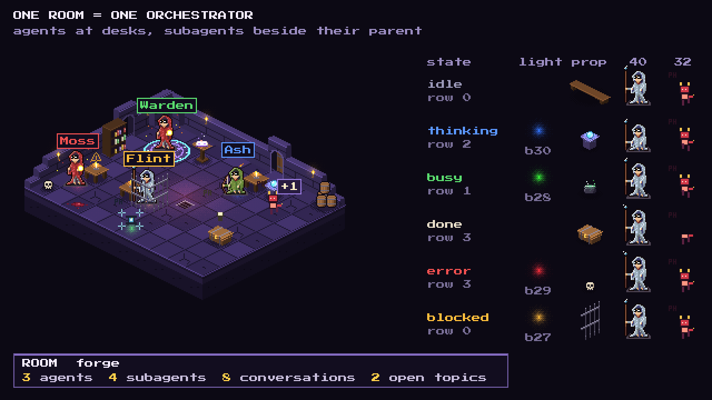
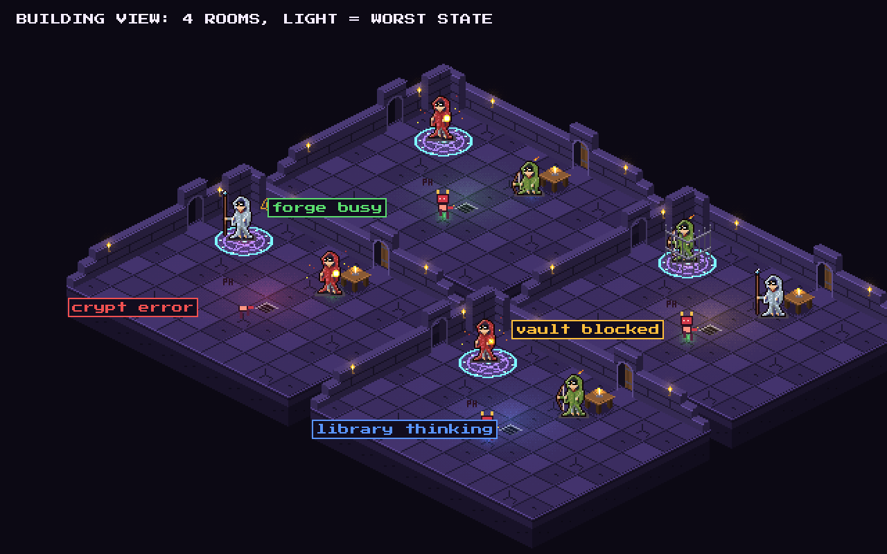

# Room layout and agent state → dungeon kit

> Ported from Spidey_PR_Dashboard PR #23 (PORT-AG1, `e81d155`) and updated from PR #27 @ `dbc7374` by Agents.
> Proposal. Where it disagrees with [`docs/building-scene.md`](../building-scene.md) (BLDG-SCHEMA), BLDG-SCHEMA is the source of truth.
> The Dungeon centre tab now draws `building/layouts/compact.json` with this kit (`cli_avatars/app/dungeon_rooms.py`).

Proposal for the Building view: one room per orchestrator, built from `Sprites/dungeon_kit/` at 2× integer scale (nearest neighbour). Docs only: no app code changes. Names in the previews are made up.

**Source of truth: BLDG-SCHEMA** ([`docs/building-scene.md`](../building-scene.md)). Where this proposal disagrees with it, BLDG-SCHEMA wins; see [Status vs BLDG-SCHEMA](#status-vs-bldg-schema). The room tables below are now data in `building/layouts/compact.json` (tiling `4`) and `building/layouts/tower.json` (tiling `16`), checked by `tests/test_layouts.py`.

## 1. Room grid

Kit grid (`Sprites/dungeon_kit/INDEX.md`): iso 2:1, a tile is 32×16 px, a height unit 16 px; at 2× a tile is 64×32. Tile (u, v) lands at `x = X0 + (u - v) * 16 - anchorX`, `y = Y0 + (u + v) * 8 - z * 16 - anchorY` (1×, then ×2). A room is 10 × 8 tiles, about 576 × 390 px at 2×.

| Part | Kit file | Tiles (u, v) |
|---|---|---|
| Rock base | `b07-roca-honda.png` (inner), `b06-roca.png` (all) | under every tile |
| Floor | `b01-losa`, `b02-losa-clara`, `b03-losa-oscura`, `b04-losa-agrietada` mixed | 10 × 8 |
| Floor centre | `b05-losa-rejilla.png` | (5, 4) |
| Back right wall | `b09-muro-der.png`, door `b16-puerta-der.png`, end `b18-remate-der.png` | v = 0, u = 1…9; door u = 6; end u = 9 |
| Back left wall | `b08-muro-izq.png`, arch `b13-arco-izq.png`, end `b17-remate-izq.png` | u = 0, v = 1…7; arch v = 2; end v = 7 |
| Corner | `b12-esquina.png` | (0, 0) |
| Torches | `b24-antorcha-der.png`, `b23-antorcha-izq.png`, `b26-halo-antorcha.png` on each flame | (2, 0), (8, 0); (0, 1), (0, 6) |
| Room light | one of `b27`…`b30` (section 3) | centre (5, 4), additive |

Front edges stay open so nothing hides an avatar. Paint order is the kit's: rock, floor, walls, light, decals, then props and avatars back to front by u + v, torches, gates.

## 2. Who stands where

The tree is orchestrator (depth 0) → agents (depth 1) → subagents (depth 2) → deeper (depth 3+).

| Node | Size | Place | Kit pieces |
|---|---|---|---|
| Orchestrator | 40×40 | on the magic circle, at the layout's `circle.spot` (an integer tile) | `o09-circulo-magico.png` at (1, 1); lectern `o10-atril-con-grimorio.png` at (3, 1) |
| Agent slot S1 | 40×40 | stands (6, 2), desk (6, 1) | `o14-mesa-con-vela.png` |
| Agent slot S2 | 40×40 | stands (4, 5), desk (3, 5) | `o14-mesa-con-vela.png` |
| Agent slot S3 | 40×40 | stands (1, 6), desk (1, 5) | `o14-mesa-con-vela.png` |
| Agent slot S4 | 40×40 | stands (8, 7), desk (8, 6) | `o14-mesa-con-vela.png` |
| Subagent C1, C2, C3 | 32×32 | parent's tile + (2, 0), (1, 2), (-1, 1) | none (row + halo only) |
| Depth 3+ | badge | `+n` pip on its depth-2 ancestor | none (see needed sprites) |

Folding rules, so a room never fills with sprites:

| Overflow | Shown as |
|---|---|
| Agents past the last desk | 1 each (plus its subtree) on the orchestrator's `badge_more` |
| Subagents past `sub_spots.max_per_desk` | 1 each (plus its subtree) on the parent agent's `badge_more` |
| Any node at depth 3+ | counted into `badge_more` of its depth-2 ancestor; never a sprite |
| Orchestrators with no free slot | `building.more_rooms`; the last slot's plaque shows `+n rooms` |

The door holds only the `blocked` bars.

Labels: orchestrator and agents get a name tag in their state colour; subagents get none. Name tags, node halos and timings are renderer extras, not schema fields.

## 3. Agent state → kit

Each node carries its state with an avatar row (plus an optional renderer halo). The room shows one prop, chosen from the room state, in its `prop_slots`. The room light shows the room's worst state: error > blocked > busy > thinking > done > idle.

| State | Room light (pool) | Node halo | Flicker (alpha of the light) | Prop | Main row (40×40, `sprite_loader.ANIM_ROW`) | Sub row (32×32, `subskins.STATUS_TO_ROW`) |
|---|---|---|---|---|---|---|
| idle | none, torches only | none | steady; dims after 5 min (`rooms.IDLE_AFTER`, `fade_image` 0.55) | `o15-banco.png` | 0 idle | idle |
| thinking | `b30-luz-azul.png` | `b26` shifted blue | slow pulse, 1.6 s, 60–100 % | none | 2 sit | working |
| busy | `b28-luz-verde.png` | `b26` shifted green | fast flicker, 3 levels at 120 ms | none | 1 run | working |
| done | none | none | candle steady, fades with the linger | `o02-cofre.png` | 3 stand | dying, once, then removed |
| error | `b29-luz-roja.png` | `b26` shifted red | steady; warn icon blinks 500 ms | `o05-calavera.png` (no blood decal unless `theme.allow_sets` lists `blood`) | 3 stand | idle |
| blocked | `b27-luz-ambar.png` | `b26` as is (amber) | slow pulse, 0.8 s | one bars piece on `door.at`: `b21-reja-izq.png` or `b22-reja-der.png`, matching `door.side` | 0 idle (no row yet) | idle |

Colours follow the thread's dungeon reading: green works, blue waits, red stopped, amber needs you. The warn icon is the existing `Sprites/talk/icons.png` cell 3 (`rooms.warn_icon`). The node halo is `b26` with a hue shift, the same method as `sprite_loader.hue_rotate_image`, until real small halos exist.

## 4. Counts plaque

One plaque per room, hung on the back right wall (`b09-muro-der.png`, between the torches): room name, then `agents · subagents · conversations · open topics`. Until a plaque sprite exists it is a text plate drawn by the app, like the Rooms list cards. The Building view header sums the same four counts over all rooms, plus the room count (= orchestrators).

## 5. Building view: 4 and 16 rooms

| Rooms | Layout at 2× | Fits 1920×1080 |
|---|---|---|
| 1 | full 10 × 8 room, as above | yes |
| 4 | `compact.json`: 2 × 2 rooms of 10 × 8 tiles, 6 desks each, origins (0, 0), (10, 0), (0, 8), (10, 8); front rooms use low walls; drawn back to front by u + v; tag on each room's west corner in its worst-state colour | yes, 1280 × 800 |
| 16 | `tower.json`: 4 floors of 2 × 2 rooms of 7 × 6 tiles, 3 desks each, `slot = floor * 4 + i`; each floor sits 12 tiles back on x and y so the floors stack on screen without hiding each other; stairs `b20-escalera-der` on floors 0–2 | at 1× |
| more | no paging: extra orchestrators are counted in `building.more_rooms` | — |

Order: slots are stable by node id; a new orchestrator takes the lowest free slot (`building/scene.py`). A click on a room opens it full size; Esc goes back.

## 6. Data each element reads

| Element | Reads | Status |
|---|---|---|
| Room | top-level session (`SessionInfo.parent_id` is None) → `rooms.RoomCard` | exists |
| Room name | `RoomCard.project` (`rooms.project_folder`), else `RoomCard.name` | exists |
| Orchestrator avatar | `RoomCard.skin`, `RoomCard.status` | exists |
| Agents (depth 1) | children by `parent_id` → `RoomCard.subs` (`SubRow`) | exists |
| Subagents (depth 2+) | `SessionInfo.parent_id` chain beyond one level | needs: tree reader; scanners fill one level today (Claude `<session>/subagents/` and Grok `subagents/*/meta.json` give counts) |
| Depth | walk of `parent_id` | needs: computed field |
| idle, thinking, busy | `SessionInfo.status` (`ClaudeJsonlSource._parse_tail`, `grok_state_from_updates`) | exists |
| error | `SessionInfo.failed` or status `error` (`rooms.needs_warn`) | exists |
| done | overlay `DONE` and `_task_done_at` / `_lingering_subs` (`overlay.py`); `done` already in `ANIM_ROW` and `STATUS_TO_ROW` | exists in the overlay, not in `SessionInfo` |
| blocked | needs: a `blocked` status when a session waits on the user (permission prompt or question), read from the Claude hook it already has (`hooks/claude_chat_hook.py`); topic status `waiting_on_user` (`topics.py`) is the topic-level twin | needs |
| Long idle dim | `rooms.is_long_idle` | exists |
| Count: agents | depth-1 children of the room | exists |
| Count: subagents | depth 2+ nodes, today `SessionInfo.subagents` | partial |
| Count: conversations | chat nodes in the room's tree (each chat is a node) | needs: tree reader |
| Count: open topics | `topics.list_topics(statuses=["open", "waiting_on_user"])`, matched on `project` | exists, needs the project match |

The room only reads and shows. It never executes chat content and never starts a CLI; a click opens the chat window, where sending stays an explicit user action (click or Enter).

## 7. Needed sprites (not in the kit)

| # | Sprite | Size (1×) | Stand-in today |
|---|---|---|---|
| 1 | Wall plaque for the counts, hangs on `b09` | about 40×14 | text plate |
| 2 | Small state halos: green, blue, red, amber (like `b26`) | 25×23 each | `b26` with a hue shift |
| 3 | Fold pip `+n` (badge for overflow and depth 3+) | about 12×9 | text plate |
| 4 | Main avatar row for `error` (row 5, as `sprite_loader` already notes: "add row 5 for custom error anim") | 40×40 × 4 frames | stand row |
| 5 | Main avatar row for `blocked` (row 6) | 40×40 × 4 frames | idle row |

## 8. Preview notes

`room_layout_preview.png`: one room, 1 orchestrator (busy), 3 agents (thinking, blocked, error), 4 subagents (idle, done, busy, and one at depth 3 folded into `+1`), a legend with every state, and the counts plaque. `room_layout_tile4.png`: four rooms, light = worst state. Both are composed from the kit files above, the 50 px avatar sheets cropped to 40×40 (`ember_mage`, `forest_scout`, `frost_wanderer`) and the 32×32 placeholder subagent sheets, at 2× nearest neighbour. Room pools are drawn at 1.6× alpha so they read in a still image.

## Status vs BLDG-SCHEMA

AG-3 answer to each point of upstream's "Differences vs BLDG-SCHEMA" list (`docs/building/ROOM_LAYOUT.md`). **done**: closed here; **theirs**: upstream code owns it, nothing to do in this folder.

| # | Topic | Status | Why |
|---|---|---|---|
| 1 | Coordinates | done | Layouts use integer `(x, y, floor)`, room-local plus `origin`. |
| 2 | Anchor | done | `manifest.json` anchors are the footprint's south vertex: `(ax + (w - h) * 16, ay + (w + h) * 8)`, light pieces `+ (0, 8)`. `INDEX.md` keeps the north-vertex values. |
| 3 | Orchestrator spot | done | `circle.spot` is an integer tile; the 1.5 spot is gone. |
| 4 | Room shape | done | Rooms come from `building/layouts/*.json`: `size`, `desks`, `sub_spots`, `plaque`, `light_points`, `door`, `prop_slots`. |
| 5 | `span` and `set` | done | Floors and wall runs use `span`; every `o` piece has a manifest `set` taken from its `INDEX.md` group. |
| 6 | Tiling 16 | done | `tower.json`: 4 floors of 2 × 2 rooms, stairs on floors 0–2. |
| 7 | Room order and overflow | done | Paging dropped; slot positions follow `slot = floor * 4 + i`. Slot assignment and `more_rooms` run in `building/scene.py`. |
| 8 | Agent overflow | done | Orchestrator `badge_more`; the door holds only the bars. |
| 9 | Subagent overflow | done | `sub_spots`: 2 offsets, `max_per_desk` 2; extras go to the parent's `badge_more`. |
| 10 | Props | done | One prop per room in `prop_slots`; none for `busy` and `thinking`. |
| 11 | `blocked` prop | done | One bars piece matching `door.side`, on `door.at`. |
| 12 | `error` decal | done | No `blood` or `torture` piece in either layout; no `theme.allow_sets`. |
| 13 | Node halos and name tags | done | Marked as renderer extras, not schema fields. |
| 14 | Animation timing | done | Marked as renderer extras, not schema fields. |
| 15 | `blocked` avatar row | theirs | `sprite_loader.ANIM_ROW` (core module). |
| 16 | `done` subagent row | theirs | `subskins.STATUS_TO_ROW` and overlay behaviour. |
| 17 | `blocked` state | theirs | Already in code (`sessions.BLOCKED`, CHAT-BLOCKED). |
| 18 | Tree and depth | theirs | CHAT-TREE `cli_avatars/model/tree.py`; the scene reads the tree, not `RoomCard`. |
| 19 | Counts | theirs | `tree.COUNT_KEYS`, five keys. |
| 20 | Conversations and open topics | theirs | `Tree.counts`. |
| 21 | Room name | theirs | Scene `title`, sanitised by `events.sanitize_text`. |
| 22 | Missing sprites | done | AG-2 drew the plaque, halos, `+n` badge, digits and the `error`/`blocked` rows; the schema needs none of them. |

Open outside the 22 points (manifest, not layouts): BLDG-SCHEMA categories are `stairs`, `torch`, `bars`, `stain`, `plaque`, while the kit uses `stair`, `light`, `door`, `decal`, `ui`, `state`, `avatar-row`; wall-hung and light pieces have footprint `[0, 0]` where the schema wants 1–4; avatar rows live in `avatar-rows/`, not a plain file name.
