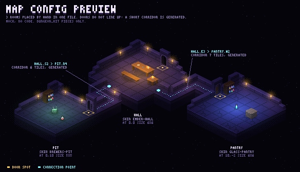

# Map config (MAP.1, proposal)

> Preview only: two images and this plan. No app code yet; it waits for the OK on the 30 skins.

Rooms are placed by hand in one file. Each room names a skin, its door spot and its connection points. When two linked doors do not line up, a short corridor is generated between them. Gold = door spot, cyan = connection point; 4× copies are `img/*@4x.png`.




## Skin rule

A skin is one pick per slot, from `Sprites/dungeon_kit/` pieces only. No new art, no tint.

| Slot | Picks |
|------|-------|
| `floor` | `slab` b01 · `pale` b02 · `dark` b03 · `worn` b01 + scattered b04 · `checker` b02/b03 · `ring` b03 rim, b02 inside |
| `wall` | `tall` b08/b09 · `low` b10/b11 · `double` b08/b09 with b10/b11 on top |
| `trim` | `cap` b17/b18 on the wall ends · `pillar` b25 at the wall ends · `plain` |
| `door` | `arch` b13/b14 · `door` b15/b16 · `gate` arch + b21/b22 bars |
| `light` | `amber` b27 · `green` b28 · `red` b29 · `blue` b30 (torches b23/b24 + b26 in every skin) |
| `props` | 2–3 different `o` pieces |

No clashing pairs, checked on all 30:

- `torture` and `blood` sets are never used (BLDG-SCHEMA decision I); `gate` only with a prop from the `dungeon` or `skulls` set.
- Glow matches the light: cauldron only under green; magic circle and crystal ball only under blue or green; red flask never under blue, blue bottle never under red.
- `checker` floor never with the magic circle; no two skins share the same floor + wall + trim + door + light, or the same prop trio.
- Result: 30 distinct skins (8 amber, 8 blue, 7 green, 7 red). All names are made up.

## File format `building/maps/<name>.json`

| Field | Rule |
|-------|------|
| `schema_version` | `1`. |
| `rooms` | Up to 16 `{id, skin, at, size, door, connections}`. `at`: `[x, y]` in building tiles; `size`: `[w, h]`, 4–16; rooms never overlap. |
| `door` | The door spot: side + tile index, e.g. `"n3"`. Sides `n` and `w` are the back walls, `s` and `e` the open front edges. It carries the skin's door piece; an avatar enters on the tile inside it. |
| `connections` | More connection points in the same form. On a back wall each is a plain arch; on a front edge, a gap. |
| `links` | Pairs of `room.point`. Each one is joined by a corridor. |

Skins live in `building/skins.json`: `{id: {floor, wall, trim, door, light, props}}`.

```json
{"schema_version": 1, "name": "demo",
 "rooms": [
  {"id": "hall",   "skin": "ember-hall",   "at": [0, 0],   "size": [6, 6], "door": "n3", "connections": ["e3", "s2"]},
  {"id": "pantry", "skin": "glass-pantry", "at": [10, -2], "size": [6, 6], "door": "w2"},
  {"id": "pit",    "skin": "brewers-pit",  "at": [0, 10],  "size": [5, 5], "door": "n4"}],
 "links": [["hall.e3", "pantry.w2"], ["hall.s2", "pit.n4"]]}
```

## Corridor rule

One tile wide, from the tile outside each point. Aligned: straight. Facing but offset: one jog at the midpoint. At right angles: one corner. Floor b01, low walls b10/b11 on the back edges, one torch at the middle. Longer than 12 tiles or crossing a room: the map is rejected and the app keeps `compact`. The example gives 7 and 6 tiles.

## Where it hooks in

- New pure module `cli_avatars/app/map_config.py`: load, validate, route the corridors, expand rooms + skins into the `structure` items that `dungeon_rooms.placements()` already paints.
- `cli_avatars/app/dungeon_rooms.py`: `paint_rooms` reads the map first and falls back to `building/layouts/compact.json`. A few lines, plus a pass for the room lights (not drawn today).
- New data: `building/maps/demo.json`, `building/skins.json`; tests beside `tests/test_dungeon_rooms.py`. `docs/building-scene.md` gains a "Map" section; layouts (`tiling` 4/16) stay as they are.

**Freeze:** `overlay.py` and the core packages (`model/`, `world/`, `physics/`) need no change. Everything is under `cli_avatars/app/` and `building/`, so the work can start before the freeze lifts. Avatars walking the corridors would touch `places.py`; that is a later step.
