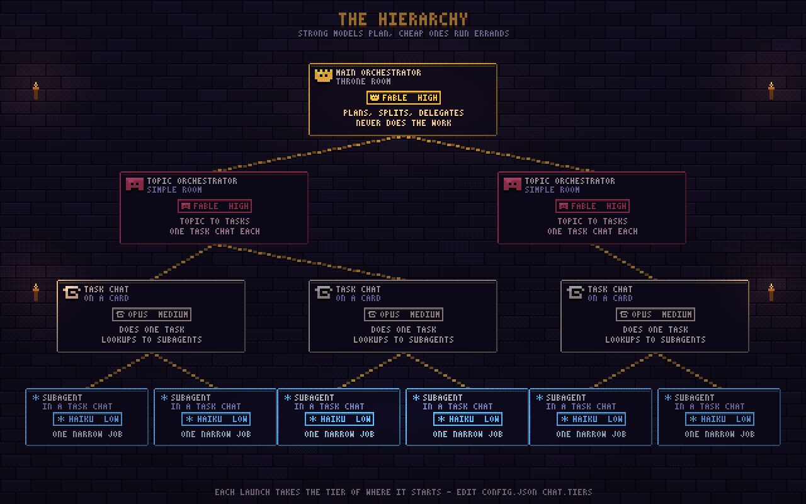

# Orchestrator hierarchy (SUMMON.1, HIERARCHY.1)



## Talk to the main orchestrator

The main orchestrator lives in the **throne room**. Open the Dungeon's **Throne** tab, or click its room on the
floor: the chat opens on its topic with the main orchestrator's CLI lit and a gold crown chip on the Run row. Type and
press Enter.

## Pick it (GROK-ORCH.1)

Grok is the main orchestrator by default. **Settings › Chat › Main orchestrator** switches it any time (Claude, Grok,
Cursor; Summon starts Claude or Grok), saved as `config.json` `orchestrator.main` and live at once: the next Summon,
the throne room's lane and New chat's first CLI follow it. A chat that is running keeps going. An older
`chat.tiers.main.cli` still counts while `orchestrator.main` is unset. Off Claude, the main tier sends no model or
effort flag unless `chat.tiers.main` sets one; its chip shows the CLI (`GROK`). A Claude model name there
(fable, opus, sonnet, haiku) is not sent off Claude; it stays saved and counts again when Claude is main.

## Create one

- **Summon orchestrator** (gold plate): shown on the Throne tab and at the top of the Sessions panel while no main
  session is open. One click opens the main session (the throne room rises) and starts its CLI with the main role and
  the throne pack (open topic rooms, the four tiers). The first Summon asks for the project folder once; the folder is
  stored in that room's chat file only and `ui/summon.json` keeps the topic name, so later Summons reuse it. A `summon`
  cue (horn and hall bell) plays on Windows, held while a task is in focus.
- **Sessions panel**: pick *Main: throne* or *Simple room*, Claude or Grok, a folder, **Open session**. This opens
  the room only; the CLI starts on your first Enter. One main at a time; up to three simple rooms.
- The phone shows "No orchestrator: summon it on the PC" while none is open. It never starts one.

## The four tiers

| Tier | Where it starts | Chip | Default | What it does |
|------|-----------------|------|---------|--------------|
| main | throne room | crown | Grok, its own model (Claude: `fable`, high) | plans, splits into topics, delegates; never does the work |
| topic | simple room | banner | Claude `fable`, high | turns its topic into tasks, one task chat each |
| task | a card's task chat | scroll | Claude `opus`, medium | does one task; sends quick lookups to subagents |
| subagent | inside a task chat | spark | Claude `haiku`, low | one narrow job, fast and cheap, then reports back |

Why: planning and splitting work is where a wrong call costs most, so the two orchestrator tiers get the strongest
model and high effort. A task chat does the work on a strong model at medium effort. Subagents do the many small,
mechanical jobs on the fastest, cheapest model.

Each launch takes its tier from where it starts. A fresh session gets the tier's role text on stdin (after the context
pack and task, before your prompt), naming who it delegates to and on which model. The app cannot pick a subagent's
model itself: the task role tells the task chat which model to ask for. The chip (crown, banner, scroll, spark) with
model and effort shows on the composer's Run row and hangs under each room's door sign; the phone shows the same
chips and a legend, read-only.

## Pick model and effort in Settings (TIERS-SETTINGS.1)

**Settings › Chat › Chat tiers** has one row per tier: its glyph, name and where it runs, a model box (suggestions
from the tier's CLI, e.g. fable, opus, sonnet, haiku for Claude, or type any plain name), an effort list and **Reset
to default**. A pick saves `chat.tiers.<tier>.model` and `.effort` at once; the sample line under the row
(`Main orchestrator: claude opus, medium effort`), the door chips and the next launch follow. A chat that is running
keeps going. The main row's CLI is the one picked above it (`orchestrator.main`); switching it changes the row's
suggestions. The phone's App sheet (⚙) shows the same rows, editable when the phone may send. **Update** keeps
`config.json`: the new build gets your file, your values win and only keys you never had come from the new build.
The defaults in `tiers.py` do not change.

## Change them

`config.json`, any tier, any field; a bad value keeps the default:

```json
{ "chat": { "tiers": {
  "task":     { "cli": "claude", "model": "sonnet", "effort": "high" },
  "subagent": { "model": "haiku", "effort": "low" }
} } }
```

Model and effort reach the argv only when the launch runs the tier's CLI:

| CLI | Model | Effort | Source |
|-----|-------|--------|--------|
| Claude | `--model <name>` | `--effort low\|medium\|high\|xhigh\|max` | `claude --help` (built in) |
| Cursor | `--model <name>` (template piece `model`) | none published: add an `effort` piece if one exists | Cursor CLI docs |
| Grok | set in `config.json` | set in `config.json` | no headless flags published |

A template CLI takes them as pieces next to its `argv`, one slot each, checked like the rest of the template:

```json
{ "chat": { "clis": { "grok": { "argv": ["<flags>"], "model": ["<flag>", "{model}"], "effort": ["<flag>={effort}"] } } } }
```

Values are plain names (letters, digits, `.`, `_`, `-`); anything else is refused and nothing starts.
