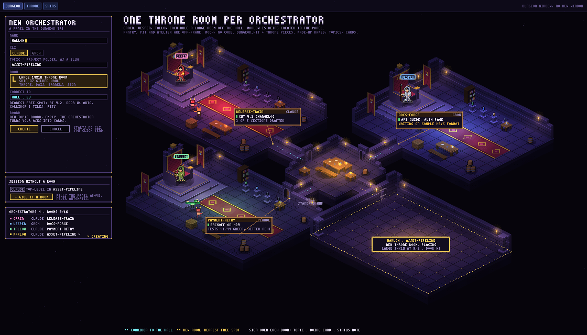
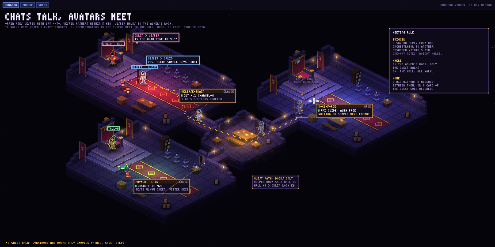

# Orchestrator rooms (ORCH.ROOM)

> START.1 built asks 1 and 2 (see "Session rooms (START.1, built)"). ORCH.ROOM built asks 3, 4 and 5 (see "Meetings, tracker and board (ORCH.ROOM, built)"). The rest of this page is the plan they came from. Made-up names, topics and cards.

## Meetings, tracker and board (ORCH.ROOM, built)

**Two defaults taken.** You did not answer the two open questions, so the plan's proposals are built. Either one can be flipped; say which.

1. Orchestrators meet in **the asker's room**. Three or more meet in the **Apothecary**, the hub (the Hall is no longer on the Dungeon floor).
2. An orchestrator may add `proposed` cards to **its own topic** without asking, 5 an hour.

**Meetings (ask 3).** An orchestrator is a live top-level session bound to a session room.

- Trigger: orchestrator A sends B a `say --to` or `reply`, and B answers within 5 minutes. A and B live in different rooms. A one-way note makes nobody walk.
- B walks to A's room through the doors and corridors (MOVE.1 paths, never through walls). A stays home as host. Three or more orchestrators in one thread (answered pairs that share someone) all walk to the Apothecary. Subagents stay home.
- Home: after 3 minutes with no message between them. A guest that goes `blocked` or `error` goes home at once (the needs-me walk wins). Moving the guest by hand (drag or Move to room) after the meeting began wins and ends its meeting.
- Nothing is stored. The meeting is worked out again from the chat rows (`from`, `to`, `ts`) about once a second.
- Sound, on by default: two soft footsteps and a low knock when a guest reaches the host's room. **Settings → Sound cues** turns it off (`config.json` `sound.cues`). Windows plays it with `winsound`. Linux and macOS have no player in the standard library, so the cue is silent there.

**Tracker (ask 4).**

- **Topics dock:** an **Orchestrator rooms** section at the top, one row per open session room: orchestrator, topic, CLI; the `doing` card; its status note (amber, the blocked card's note, while a card is blocked); counts of todo, doing, review and blocked; the last board line and how long ago. A click selects the topic everywhere (chat, Tasks, Throne) and frames its room on the Dungeon floor: the camera glides there in about a fifth of a second (NAV.1; from the whole map it zooms one level in first) and the room lights up for about two seconds, the same light as a drag. A soft `whoosh` plays on the jump (Windows, with **Sound cues**), held while a task is in focus. How to move around the floor: `windowed-dungeon.md`, "Moving around the floor (NAV.1)".
- **Door signs:** a wooden sign hangs over each session room's door, in the throne room's pixel font at the floor's own scale: topic, doing card, status note. The rim and the note turn amber while a card is blocked.
- **Throne tab:** shows the selected topic's room and its lord (the newest top-level session there). With no orchestrator room selected, it shows every agent as before.
- **Phone:** each session room's label on the map has its door sign under it (doing card and note, amber when blocked). The phone has no Topics rows yet.
- **Data:** cards by topic from every board and the newest event in the cards' own history (the same events as `events.jsonl`, without reading the whole log). Reads go through `StoreThrottle`: every 2 seconds for the dock and the signs.

**Rising light (SELECT-LIGHT.1).** The light of a selected room (a Topics row click, or the room of a dragged avatar) does not just fade in: it rises from the floor like rain falling upwards. A burst of small warm drops leaves random spots of the room's floor, each a short glint on the tiles, then a white-hot head over a dithered amber tail climbing to about wall height and fading near the top, while the room's torchlight ramps up under them. Once the glow is in, a few drops a second keep rising while the light holds (a sparse loop); at most 48 at once. A deselect stops new drops and fades the rest with the glow; picking another room moves them there. A soft `shimmer` (glassy pings rising over a faint swell) plays when the drops start (Windows, with **Sound cues**). While a task is in focus the drops and the cue wait. `config.json` `"room_glow": {"drops": false}` turns the drops off and keeps the glow. The phone map draws the same drops on the picked room (held in focus; the switch is desktop only). Code: `room_rise.py` (drops, sprites drawn once per look and scale, pooled canvas items, the cue), `webui/static/rise.js`. Evidence with made-up data: `tools/shot_rising_light.py`, `tools/shot_phone_rise.js`.

**Board (ask 5).** With the agents switch off, `task_propose` is allowed only on the topic of an open session room, by an agent that the topic lists, 5 an hour. Another room's topic is refused (`not_owner`); a topic with no open room is refused (`switched_off`). With the switch on, nothing changed.

**Code:** `cli_avatars/app/orch_rooms.py` (no Tk: binding, meeting and home rules, row and sign text), `cues.py` (the sound), `door_signs.py`, `orch_dock.py` (Topics rows), `inside_roster.py` (the walks), `room_glow.py` (the frame), `throne_model.py` and `throne_panel.py` (the lord), `registry/policy.py` and `registry/agent_api.py` (propose), `webui/scene.py` and `static/app.js` (phone signs). `tools/shot_orch_rooms.py` draws the evidence with made-up data. No change to `overlay.py` or the core packages.

## Session rooms (START.1, built)

- The Dungeon starts with one room, the **Apothecary** (the old Pantry). With no sessions open, every avatar and you roam it. Hall, Pit and Atelier are not drawn on the Dungeon floor any more; the Atelier stays on the Throne tab, through the throne room door.
- **Sessions** panel, at the top of the Topics dock (no new window): Simple room or Main: throne, Claude or Grok, Folder… (the project folder; its name is the topic), Open session. Each open session has a row with End.
- Opening a session adds its room at once, with a short build-in (the floor rises out of the dark, a band of dust, the torchlight flares and settles). A **simple** session gets a mid room (10x8). The **main** session gets the large throne room (14x10, dais, throne, carpet). Only the main orchestrator gets the large room, and only one main is open at a time: a second main is refused and the panel says to open it as simple. Up to three simple rooms.
- Rooms sit on fixed spots around the Apothecary (main north, simple east, south, west), each joined by a short corridor with an arch at each end. Rooms never overlap.
- **Binding.** A live top-level session whose CLI and project folder match lives in that room, its subagents with it. Other avatars stay in the Apothecary. A room you picked with Move to room still wins.
- **Lifetime.** A room lasts as long as its session. End walks everyone in it back to the Apothecary through the corridor; then the room goes. Open sessions are kept in `ui/session_rooms.json` (topic, kind, CLI, spot; no paths).
- Opening starts no CLI. The chat opens on the topic; the CLI starts only on Send or Enter there, and the chat's own folder dialog sets the working folder on the first Enter (`room-chat.md`).
- Code: `cli_avatars/app/session_rooms.py` (model, layout, binding; no Tk), `session_walks.py`, `session_panel.py`, `room_build.py`, `throne_stamp.py`. ORCH.ROOM added an event-sound path (`cues.py`); a new room makes no sound yet.

## The asks

1. A way to create an orchestrator.
2. Each orchestrator gets its own room.
3. When chats talk to each other, their avatars meet in one room.
4. At a glance: what each orchestrator and topic is working on now.
5. Each orchestrator runs its topic and that topic's task board.

## Today (from the repo docs)

- An orchestrator is a top-level session: Claude (`sessions.py`, `parent_id` None) or a live Grok session. Its topic is the project folder as a slug (`agent-chat-protocol.md`). Subagents follow their parent.
- The Throne tab shows one hall. Its lord is the first top-level agent by id (`throne-room.md`, `throne_model.seat`).
- Rooms: MAP.1/ROOMS.1 (`map-config.md`, not built yet) put rooms in `building/maps/main.json`. A room has an optional `topic`. **Create your room** puts a room on the nearest free spot, with a corridor and a door. `large` is 14x10, the throne hall's size. Only the main orchestrator gets a `large` room (START.1).
- Rooms built from the phone (PHONE.3, `phone-view.md`): kept with the session rooms in `ui/session_rooms.json` (`rooms`: name, topic, size, skin, room and point it hangs off; `looks`: the Apothecary's skin), placed by `room_place.py`, dressed by `room_skins.py`. Session rooms are S or M; L stays the main orchestrator's.
- Room chat (`room-chat.md`): one orchestrator chat per topic, `room_chat/<topic>.json`.
- Board (`board.md`, TASKBACK): cards have `topic`, `assignee`, `column` and `status_note`. An AI changes only the column, progress, status note and checklist (Agent API).

## 1 + 2. Create an orchestrator, one room each



- **New orchestrator** is a panel inside the Dungeon tab, next to Create your room. No new window. Fields: name, CLI (Claude or Grok), topic (the project folder slug), skin, connect to. Create adds a `large` throne room using the ROOMS.1 rule: nearest free spot, generated corridor, door facing the chosen point. It is saved in `main.json`. It starts no CLI; you start one with the Send click or Enter.
- The room has the throne-room pieces: throne, dais, carpet, banners, state crystals, door sign.
- One orchestrator has one room, and one topic has one room. Deleting the room deletes the orchestrator. Its board and topic stay.
- **Binding.** A live top-level session whose topic and CLI match a room sits on that room's throne. If several match, the newest `last_seen` is the lord and the others stand in the room. Its subagents stand beside it.
- **Running session with no room.** A top-level session in a folder that has no room shows in the Topics dock with **+ Give it a room**. One click fills the panel. Rooms are never created automatically: a short session would leave a permanent room on the map.
- The Throne tab shows the room the camera is on, or the selected Topics row, instead of the first agent by id.

New field on a room in `building/maps/main.json`:

```json
{"id": "orrin", "standard": false, "skin": "crimson-chapel", "at": [-18, -3], "size": "large",
 "door": "e6", "topic": "release-train", "orchestrator": {"name": "orrin", "cli": "claude"}}
```

| Field | Rule |
|-------|------|
| `orchestrator` | Optional. Allowed only on a `large` room with a `topic`. At most one room per topic. |
| `orchestrator.name` | `^[a-z0-9][a-z0-9-]{0,23}$`. Shown on the name tag and the Topics row. |
| `orchestrator.cli` | `claude` or `grok`. With the topic, it picks the session to bind. |

## 3. Chats interacting: avatars meet



| Rule | Detail |
|------|--------|
| Trigger | A `say --to` or `reply` from orchestrator A to orchestrator B, answered by B within 5 minutes. A and B are bound to different rooms. Data: the chat store's channel rows (`from`, `to`, `ts`). A one-way note makes nobody walk. |
| Which room | Two orchestrators meet in **the asker's room**: B walks and A stays on its throne as host. Three or more orchestrators in one thread within 5 minutes meet in **the Hall**, and they all walk. |
| Walk | MOVE.1 paths: through doors and corridors, never through walls. The guest's throne shows as empty. Subagents stay home. |
| Home | After 3 minutes with no message between them. Also when the guest goes `blocked` or `error`: the needs-me walk wins. A manual MOVE.1 move wins and ends the meeting. |
| Stored | Nothing. A meeting exists only while it runs. `ui/avatar_places.json` keeps the home room. |

## 4. Tracker: what each orchestrator is on


- **Topics dock.** This is today's left dock (`rooms_panel.py`, TASKBACK 1.1) with bigger rows. No new tab or store. Each row shows: orchestrator, topic, CLI, the `doing` card, its `status_note`, the counts (todo, doing, review, blocked) and the last board line. Clicking a row moves the camera to that room, frames the room and selects the topic everywhere.
- **Door sign** over each room's door: the topic, the `doing` card title, and the `status_note` (amber when a card is blocked).
- **Data.** Board cards by `topic` (`LocalStore.list`), the doing card's `status_note`, and the newest event in `events.jsonl`. "Last activity" is the newer of the newest board event and the session's `last_seen`. These are read with the existing `StoreThrottle`, the same way as the throne board.
- **Who writes.** The AI writes the column, progress, status note and checklist. You do the rest.

## 5. The orchestrator runs its board

Same paths as today. No new process, and nothing executes chat text.

1. Your ask reaches its inbox through the chat window or room chat (To: orchestrator of the topic). It reads the ask with `inbox read` or the hook block.
2. It turns the ask into a card with MCP `task_propose`: a `todo` card labelled `proposed`, with the topic and the orchestrator as assignee. **Proposed change to Decision C:** an orchestrator room switches propose on **for its own topic only**. The limit of 5 per hour stays.
3. It moves cards with `task_status` (todo, doing, review, blocked), writes where it is with `task_progress --note` (this is the door sign's third line), and ticks steps with `task_check`.
4. Subagents have no inbox and no stable id. Their work is checklist lines on the orchestrator's card, not assignees.
5. It reports with `say` or `reply` on the topic.
6. Only you can do these: `done`, archive, retitle, reassign, and delete or empty the archive (Decisions B, C, D).

## Freeze and the code ticket

- **Frozen** until about 30 Nov: `overlay.py` and the core packages (`model/`, `world/`, `physics/`). None of them change. All the work is in `cli_avatars/app/`, `registry/` and `building/`.
- **Depends on** MAP.1 and ROOMS.1 landing first: `map_config.py` and `main.json`.
- **Files the code ticket touches:**
  - New `cli_avatars/app/orch_rooms.py`, with no Tk: binding, the meeting and home rules, and sign text.
  - `map_config.py`: the `orchestrator` field.
  - `dungeon_rooms.py`: throne pieces and door signs per room.
  - `dungeon_window.py`: the New orchestrator panel.
  - `rooms_panel.py`: Topics rows.
  - `throne_model.py` and `throne_panel.py`: the lord per room.
  - `inside_roster.py` and `room_floor.py`: the meeting walks.
  - `registry/agent_api.py` and `registry/policy.py`: propose limited to the orchestrator's own topic.
  - Tests beside the existing ones.

## Open questions

1. Meeting room: the asker's room (proposed), or always the Hall? **Default taken (ORCH.ROOM):** the asker's room; three or more in the Apothecary.
2. May an orchestrator add `proposed` cards to its own topic without asking (proposed), or only suggest them in chat so you click Add? **Default taken (ORCH.ROOM):** it may, on its own topic only, 5 an hour.
3. A running session with no room: one click to give it a room (proposed), or create the room automatically? **Answered (START.1):** the room appears when you open the session from the Sessions panel, and goes when you end it.

The images are drawn in code from `Sprites/dungeon_kit` and `throne_pieces.py`. Each has an `@4x` copy.
