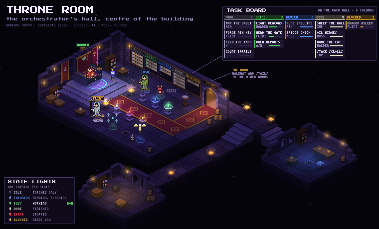

# Throne room

The orchestrator's hall, centre of the building. It is the **Throne** tab of the Dungeon window, beside
Dungeon and Skins. It follows the approved preview (`docs/img/throne-room-preview.png`, PR #22).

## What it shows

| Part | Source |
|------|--------|
| Hall, walls, floor, props, walkway, stairs, two far rooms | `Sprites/dungeon_kit` tiles, anchors from its `INDEX.md` |
| Throne, dais, carpets, banners, door sign, crystals, wall board | Drawn in code (`throne_pieces.py`), captured once as sprites |
| Lord on the throne (40x40) | First top-level agent by id |
| Agents in the hall (40x40) | Other top-level agents, six spots; more show as `+n MORE` at the door |
| Subagents (32x32) | Two beside each parent; extras and deeper nodes add `+n` to the parent's tag. `fly` skins float |
| Task board (wall and readable panel) | The lord's project board (`board.store.LocalStore`), five columns, newest four cards each |
| State crystals | One per state. A crystal lights when an actor is in that state. The worst state is `NOW` and sets the room light (same pieces as BLDG-SCHEMA) |
| Door | Click it to go back to the Dungeon tab |

## Drawing

- One 760x460 image at 1x, shown at the largest integer scale that fits (nearest neighbour).
- Light: ambient plus lamps, multiplied in and dithered to twelfths; actors stay bright. Torch and crystal
  halos are added after. Four frames move the torch glow and the sparks.
- The tab reads agents and the board once a second while it shows. A changed room is drawn on a worker
  thread (about 0.3 s for four frames); the Tk thread only swaps images.

## Screenshot

`python tools/shot_throne_room.py` opens the Dungeon on the Throne tab with made-up agents and a made-up board
in a temporary data directory.
