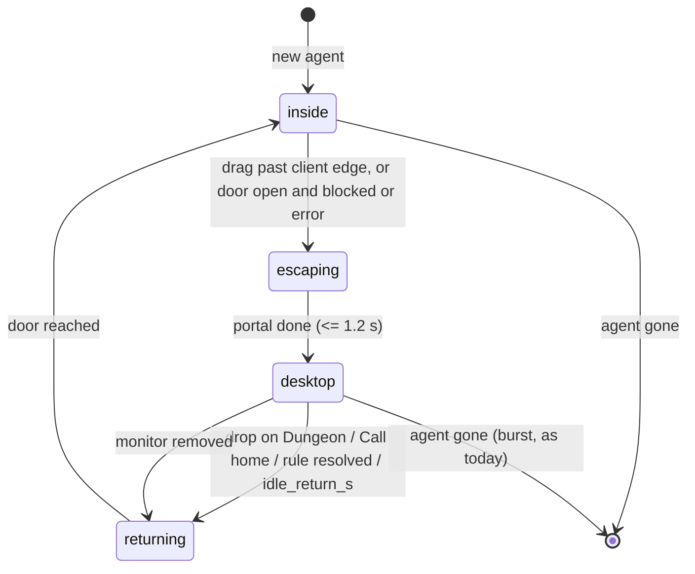

# Windowed dungeon (WIN-DUNGEON)

Design only. No code moves in this task. Builds on
[`architecture.md`](architecture.md) (package layers), [`building-scene.md`](building-scene.md)
(BLDG-SCHEMA) and [`building/ROOM_LAYOUT.md`](building/ROOM_LAYOUT.md).

Daniel's request (23/11/2026, translated): "I'm not happy with the windows that get
generated. Make the Windowed window always be there, with the dungeon. But the avatars
inside can stay in the window or 'escape' onto the desktop. All screens, taking into
account how they are arranged."

Names used below:

| Term | Meaning |
|------|---------|
| Dungeon | The one persistent app window. It shows the isometric BLDG scene and docks every panel. |
| Overlay | Today's transparent, topmost canvas where avatars walk on window tops. After this work: one per monitor. |
| Place | Where an avatar lives right now: `inside` (drawn in the Dungeon scene) or `desktop` (drawn on an overlay). |
| Virtual px | Windows virtual-desktop coordinates in physical pixels. The primary monitor's top-left is `(0, 0)`; other monitors can have negative origins. |

---

## 1. Current state

The code has no modes called Windowed, Free or mobile. The names map to:
Free = today's overlay (`WINDOW-PERCHES-PLAN.md` calls it "Free mode"),
Windowed = the planned BLDG.2 Building `Toplevel`, mobile = the WEB epic (phone view).
Only Free exists today.

### 1.1 Windows the app creates

| # | Window | Code | Style | When it appears | Why Daniel may dislike it |
|---|--------|------|-------|-----------------|---------------------------|
| 1 | Overlay root | `app/shell.py` | `tk.Tk`, borderless, topmost, chroma key `#010101`, size of the **primary** monitor at `+0+0` | Always | Invisible but takes every click on the primary monitor (CLICK-THROUGH not done). Right-click on empty space quits. Other monitors get no avatars. |
| 2 | HUD "AI Overlay" | `app/hud_window.py` | Borderless `Toplevel`, not topmost, alpha 0.92, hand-made title bar, `560x460+10+10` | **Every start** (`_deferred_init`). `x` only withdraws it | Pops up on each launch at a fixed corner. No taskbar entry, so once behind another window it is lost; only the bubble icon or tray brings it back. |
| 3 | Topics ("Rooms" button) | `app/rooms_panel.py` | Borderless `Toplevel`, `440x520+580+10` | HUD button; reopened at start when the `rooms` flag in `config.json` is `true` | Fixed spot next to the HUD, no taskbar entry, position not remembered. |
| 4 | Chat | `chat_window.py` via `app/chat.py` | Framed `Toplevel`, `1040x680+80+60` or `chat.window` from `config.json` | **A short click on any avatar**, or the HUD Chat button | A large window opens on every avatar click. |
| 5 | Skins picker | `app/skin_picker.py` | Framed, **topmost**, `1000x700+80+60` | HUD or tray | Topmost and large; covers work. |
| 6 | Config | `app/config_screen.py` | Framed, **topmost**, fixed `340x460+300+80` | HUD or tray | Topmost, not resizable. |
| 7 | Tray icon | `desktop/tray.py` | pystray menu | Always (when Pillow and pystray load) | Not a window; it is the only reliable way back to 2, 5, 6. |
| 8 | Building view (planned) | BLDG.2 `app/building_window.py` | `Toplevel` | Not built | Would be one more separate window. |

`--selftest` (`app/main.py`) builds the HUD and chat off-screen; it never shows them.

In short: five visible window styles (two hand-dragged borderless, three framed, two topmost),
all hard-coded near the top-left of the primary monitor and stacked on each other, only the chat
remembers its box, and the borderless ones have no taskbar entry.

### 1.2 Multi-monitor today

- Overlay size is `winfo_screenwidth/height` (primary only) at `+0+0` (`app/shell.py`).
- Terrain gets `screen=(0, 0, sw, sh)` (`world/terrain.py`); `win32.screen_rect()` is the primary rect.
- `win32._monitor_rect` is used only to detect fullscreen windows.
- Dragging clamps avatars to `0..sw, 0..sh` (`app/input.py`).
- DPI: `win32.set_dpi_aware()` sets per-monitor V2 at import (`desktop/capabilities.py`), so all
  Win32 rects are physical virtual px. Tk 8.6 does not rescale on `WM_DPICHANGED`; `tk scaling`
  is fixed at startup from the primary monitor.

---

## 2. Picture

Example layout used in this doc and in the tests: M1 primary 1920×1080 at 100 %, with the
taskbar; M2 2560×1440 at 150 % to the left and 360 px higher; M3 portrait 1080×1920 to the right,
bottoms aligned with M1.

```text
virtual px  x=-2560              x=0                    x=1920        x=3000
                                                         +-------------+  y=-840
                                                         |             |
            +--------------------+                       |     M3      |
  y=-360    |         M2         |      dead zone        |  1080x1920  |
            |  2560x1440, 150 %  |    (no monitor)       |    100 %    |
            |                    |                       |             |
  y=0       |  +--------------+  +-----------------------+             |
            |  |   DUNGEON    |  ||        M1           ||             |
            |  | Topics|scene |  ||  primary 1920x1080  ||    o        |
            |  |   |Chat      |  ||       100 %         ||   desktop   |
            |  +--------------+  ||   o  desktop avatar ||   avatar    |
            |                    ||=====taskbar==========||             |
  y=1080    +--------------------+-----------------------+-------------+

  One topmost, click-through overlay per monitor: Overlay M2 | Overlay M1 | Overlay M3.
  ||  passable shared edge (y-ranges overlap). M1's top edge is a ceiling (dead zone above).
```



Wander ("let them roam free") is not on this diagram. It is WIN-DUNGEON.8,
and it still requires the door to be open.

DOOR.1 (supersedes the open-door rule below): door open, every session avatar walks out and stays on the desktop (Call home or a drop keeps one in until it needs the user); closing the door calls everyone home and none leave.
Needs the user = `blocked` or `error`: on the desktop the avatar runs to the mouse pointer's x on its floor and waits there until clicked or answered, then wanders on.
Door closed: a needing avatar stays in, hops at the door and the arch flashes. Subagents follow their parent; bots stay in.

---

## 3. The Dungeon window

### 3.1 Decisions

| Topic | Decision | Why |
|-------|----------|-----|
| Root | The Dungeon becomes the `tk.Tk()` root. Overlays become `Toplevel`s. | The root owns the app icon, taskbar button and Alt-Tab entry. Today the root is the invisible overlay, which is why nothing "owns" the app. |
| Frame | Native framed window. Dark title bar via `DwmSetWindowAttribute(DWMWA_USE_IMMERSIVE_DARK_MODE)` when available. | Windows gives drag, resize, Aero snap, taskbar, Alt-Tab and DPI-correct borders for free. Borderless is what makes the HUD and Topics panel get lost today. |
| Size | Resizable, `minsize` 720×480 client. First run: 70 % of the primary work area, centred. | One 2× room is about 576×390; docks need the rest. |
| Scene zoom | Integer only (BLDG-SCHEMA). `auto` = largest integer 1–3 at which the building fits the scene area; otherwise the scene pans (drag on empty floor, mouse wheel). | Pixel art, nearest neighbour, no fractional scale. |
| Always on top | Off by default. Pin button in the toolbar and `dungeon.topmost`. | Optional, as asked. |
| Close (`WM_DELETE_WINDOW`) | Asks in a parchment panel inside the Dungeon: **Minimize** (Enter, default) or **Close** (quit); Esc cancels. "Remember my choice" stores `desktop.on_close` (`ask`, `minimize`, `quit`), changeable in Settings, Display, "When I close". Close takes the tray Quit path. Minimize hides the window to the tray: avatars, events and the phone view keep running, a one-time tray notice says so. Without a tray icon, Minimize iconifies to the taskbar (decision A, BG.1). | The app keeps working in the background; the window can always come back. |
| Minimise | Normal minimise to the taskbar. Inside avatars are not drawn; scene state still updates at 2 Hz. Desktop avatars keep walking. Tray click or taskbar restores. | No surprise escapes on minimise. |
| Escape key | No longer quits. ESC closes the focused dock tab or cancels a drag. Quit is the window `x`, tray Quit, or the toolbar menu. | Today ESC and right-click on empty space quit the app by accident. |
| Remembered geometry | Per monitor configuration (3.3). | Docking a laptop must not put the window off-screen or on the wrong monitor. |

### 3.2 Popups become docks

```text
+-------------------------------------------------------------------------------+
| PANELS [<o Topics][Chat o>]  DESKTOP [Door: open][Call home]   WINDOW [Pin][Menu] |
+------------+--------------------------------------------------+---------------+
| Topics     |  [ Dungeon | Skins ]                              | [Chat|Settings]|
| (rooms     |                                                   |               |
|  panel)    |       isometric scene (BLDG.1 scene JSON)         |  ChatWindow   |
|            |       inside avatars at circle / desks            |  in a frame   |
|            |                                                   |  [pop out]    |
+------------+--------------------------------------------------+---------------+
| Claude 3 · Grok 1 · 5 subagents   talks: ...   decisions: 2 open             |
+-------------------------------------------------------------------------------+
```

| Today | In the Dungeon | Notes |
|-------|----------------|-------|
| HUD window (2) | Toolbar + status bar | Same rows (`hud.hud_status_lines`, talks, decisions caption). The HUD `Toplevel` is removed. The overlay bubble icon raises the Dungeon. |
| Topics panel (3) | Left dock, collapsible | `_build_rooms_win` builds into a `Frame` instead of a `Toplevel`. |
| Chat (4) | Right dock tab "Chat", collapsible, with **Pop out** | `ChatWindow` takes a parent container; pop out re-parents into a framed `Toplevel` whose box is remembered (today's `chat.window`). Avatar click opens the dock tab, not a new window. |
| Config (6) | Right dock tab "Settings" | `_build_config_ui(win)` already takes a container. Not topmost. |
| Skins picker (5) | Central tab "Skins" beside "Dungeon" | `_build_picker_ui(win)` already takes a container. The picker's own frame timer stops when the tab is hidden. |
| Tray (7) | Kept: Show Dungeon (default item: tray click opens the Dungeon at its last rect), Door open/closed, Call home, Quit | Callbacks still go through `root.after(0, …)`. "Let them roam" waits for WIN-DUNGEON.8. |
| Building window (8) | The central "Dungeon" tab | BLDG.2 becomes a widget (`app/building_view.py`), not a `Toplevel`. |

**Tasks tab (TM.3).** Central tab "Tasks" beside Dungeon and Skins: a read-only kanban of the chat's
topic cards from every board (todo, doing, review, done collapsed, blocked; assignee, progress,
checklist done/total). `app/tasks_view.py` (no Tk) and `app/tasks_panel.py`; rooms tick, ≤ 1/s.
Since KANBAN.1 Daniel edits it too: "+ New task", a card panel drawn over the board's right edge,
drag between columns (`app/tasks_edit.py`, `app/tasks_card.py`; see [board.md](board.md) § Tasks tab).

**Board (TASKBACK.5).** The Tasks tab is the board:

| Part | What |
|------|------|
| Filters | Two pills beside the title: **Project** (all projects, or one board) and **Topic** (*Chat topic* follows the chat dock, as TM.3 did; *All topics*; or one topic of that project). The title names both. |
| Card | As TM.3, plus a wine slip when the card has task chats: a pixel speech bubble, `N chats · <last reply>` (the newest AI line of its chats, `TASK` lines cut, redacted, one line, at most 80). A click on the slip opens that chat in the chat dock; a click elsewhere opens the card panel. |
| Move | Drag the card to another column (a parchment ghost follows the pointer, the target column lights up); right-click or Shift+F10 for "Move to"; Ctrl+Left/Right moves the focused card one column. Each is one `moved` event as `daniel` through the registry and plays the `move` cue (a card slid and set down, Windows, off in Settings). Agents still never reach `done`. |
| Live | The rooms tick reloads the board at most once a second. Only cards that changed are touched: same widgets with new text when the card keeps its shape, one rebuilt card when a line appears or it changes column, nothing else redrawn, so agent updates do not blink. The redraw takes about 0.2 ms (≤ 2 ms is tested; `TasksPanel.draw_ms`). |
| Selftest | `overlay.py --selftest` builds the board off-screen from made-up cards. |

`app/tasks_view.py` (`ALL`, `board_choices`, `chat_digest`, `last_reply`; channel files are parsed again only when they change) and `app/tasks_panel.py`. Tests: `tests/test_board_tab.py`.

**Quick capture (QUICK-CAPTURE).** **Ctrl+Space** anywhere in the Dungeon window (not a system-wide
hotkey) drops a capture strip over the top of the centre pane; no new window opens.

| Part | What |
|------|------|
| Text | One line. The first line becomes the card title (cut at 120 with `…`); a longer thought also goes into the notes. Empty is refused under the line. |
| Topic chips | The suggested topic and two alternates; Tab picks the next, a click picks one. The suggestion is local (`registry/capture.py`): the words of the thought are matched against each open topic's name and title (weight 3), its open task titles (2) and its last 20 chat lines (1); best total first, ties and no match go to the Board filter's topic (else the chat's). No network, no AI CLI. Task-chat rooms are not topics to capture into. |
| Card / Chat | Card: one `todo` card in the topic's board, `created` by `daniel` through the registry. Chat: the same card plus one Claude task chat on it, opened in the chat dock; no CLI starts until Enter there ([task-chats.md](task-chats.md)). |
| Keys | Enter saves, Esc closes (the strip only; the Tasks tab stays). |
| Landing | The Board refreshes in place (only the new card is built, the others keep their widgets) and the new card gets a gold edge for a moment; a wine toast says where it went. The `capture` cue plays (a quill scratch and a soft two-note pluck, drawn in code; Windows, off in Settings). |

No "Ask Claude" chip: the local ranker answers at once, and a Claude turn needs a room with a folder
and a confirmed binary. `app/capture_strip.py` (Tk) and `registry/capture.py` (no Tk). Phone:
[phone-view.md](phone-view.md#quick-capture). Tests: `tests/test_quick_capture.py`.

**Toolbar kinds (TOOLBAR.1).** Three kinds of control, each with its own look and a tooltip
inside the window (no `Toplevel`) that says what it does:

| Kind | Controls | Look |
|------|----------|------|
| Tab | Dungeon, Skins, Tasks (centre); Chat, Settings (right dock) | Tab strip; the selected tab is joined to its panel with a lit top accent |
| Panel toggle | Topics, Chat (toolbar, PANELS) | Lamp lit and sunken while open; the arrow points to the side the panel opens on |
| Desktop / window action | Door, Call home (DESKTOP); Pin, Menu (WINDOW); Pop out (right dock) | Raised buttons on their own plate; Pop out is the only control that opens a separate window |

`app/toolbar_kit.py` (no Tk: kinds, tips, colours, icon pixel maps) and `app/toolbar_widgets.py`
(PhotoImage icons, `Tab`, tooltips).

After this work the app shows **one** normal window plus the overlays (which are invisible and
withdrawn when they hold no avatar). The only optional extra is the popped-out chat.

### 3.3 Remembered geometry

- Monitor signature: first 12 hex characters of SHA-1 over the sorted list of
  `(rcMonitor, dpi, is_primary)`. No device names, no user data.
  Canonical text, from WIN-DUNGEON.1: rows sorted by
  `(left, top, right, bottom, dpi, primary)` with primary as `1` or `0`,
  each row `left,top,right,bottom,dpi,primary`, rows joined with `;`.
- Stored per signature: client rect in virtual px, `normal`/`zoomed`, zoom, pan, dock widths,
  open tabs. At most 8 signatures, least recently used dropped.
- On start and on a layout change: use the stored entry for the current signature. Otherwise
  keep the current rect if at least a 120×40 px title strip lies inside some monitor's work
  area; otherwise centre on the primary work area.
- Written on `<Configure>` (debounced 1 s) and at quit.

---

## 4. Avatar place

### 4.1 Rules

| Rule | Decision |
|------|----------|
| Default place | New agents start `inside` (at the circle or their desk from the scene). |
| Inside | Drawn only on the Dungeon canvas at their scene `spot`; no gravity, no terrain. No overlay `Avatar` is created for them, so overlay cost is zero. |
| Desktop | Today's overlay behaviour: gravity, perches, walls, meetings, bubbles, spring children. |
| Drag out | Press an inside avatar and drag. While the pointer is in the scene, the sprite follows it on the Dungeon canvas. When the pointer leaves the client rect by more than 8 px, hand-off: an overlay `Avatar` is created at the pointer (minus the grab offset) in virtual px, place = `desktop`, and the drag continues. Tk's implicit pointer grab keeps delivering `<B1-Motion>` to the Dungeon canvas outside the window, with `x_root/y_root` in virtual px. Release throws with today's `THROW_SCALE` clamp. |
| Drag in | Releasing a dragged desktop avatar with the pointer inside the Dungeon client rect, where no other window covers that point (4.3), starts `returning`. |
| Walk in | Walking into the Dungeon rect does **not** return an avatar. The Dungeon's top frame edge is a perch, so avatars can sit on the roof of their home. |
| Call home | Toolbar / tray button: every desktop avatar returns. Right-click menu on one avatar: "Go home". |
| Door | Decision B. Daniel opens and closes the Dungeon door. Default **open** (the old recommended `attention` behaviour). **Open:** an agent that turns `blocked` or `error` may escape and returns when that state clears. **Closed:** avatars leave only when dragged out. Drag-out works in both positions. "Let them roam free" is WIN-DUNGEON.8 and does nothing while the door is closed. |
| Idle | A desktop avatar idle for `dungeon.idle_return_s` (300 s, today's vanish time) returns home instead of vanishing (decision E). |
| Monitor removed | Avatars on that monitor return home. |
| Linux / macOS | Always `inside` (5.6). |

### 4.2 Animation

Uses kit and existing pieces only; no new art required.

- The door is a control as well as a tile (decision B). While Daniel leaves it open, the
  door shows the open arch (`b13-arco-izq` / `b14-arco-der`, matching `door.side`). While
  closed, it shows the closed door (`b15-puerta-izq` / `b16-puerta-der`). The toggle itself
  lands in WIN-DUNGEON.6, not in the monitor step.
- Escape (≤ 1.2 s) runs for a drag-out in either door position, and for a `blocked` or
  `error` agent only while the door is open. Walk from the spot to the room's `door.at`
  (BLDG-SCHEMA) at walk speed, capped at 0.6 s. A drag through a closed door swaps in the
  open arch for that one crossing, then the door closes again. The sprite fades out at the
  door. On the desktop side,
  `portal.PortalPlayer` opens just outside the Dungeon client rect at the border point nearest the
  door's screen position; the avatar steps out and falls to the nearest floor.
- Return: the portal opens at the avatar's position, the avatar shrinks into it (existing burst),
  then appears at the door and walks to its spot.
- Size: inside sprites draw at scene zoom `z`, desktop sprites at
  `avatar_scale × monitor_factor` (5.4). The portal hides the size change; feet (bottom-centre)
  stay on the same virtual point at hand-off.
- Dungeon minimised: escape starts directly from the portal at the last restored rect; return is
  the burst only.
- Dungeon maximised (no "outside" on that monitor): the avatar appears on the overlay above the
  Dungeon and stands on that monitor's work-area ground. Overlays are always above the Dungeon.

### 4.3 Subagents and meetings

- Subagents always share their parent's place. When a parent escapes, its children follow
  through the same portal, staggered 150 ms. A child cannot be dragged across alone; dropping it
  on the other side snaps it back to its parent.
- Inside: children stand on `sub_spots`; no spring line (adjacency shows the link).
- Desktop: spring line and leash as today.
- **No line ever crosses the window border.** During the ≤ 1.2 s transition, children on the
  other side are drawn at the portal with a fade. A cross-border line would be drawn on the
  overlay over unrelated windows when the Dungeon is covered.
- Meetings (`meetings.py`) and the meeting portal run only between desktop avatars. A planned
  meeting with an inside partner is skipped.
- Drop occlusion check: the point counts as "on the Dungeon" when it is inside the client rect
  and no window from `win32.list_windows` with a lower z than the Dungeon contains it.

### 4.4 Roster and the needs-me walk (AV.1)

- Inside, each kind wears one repo sprite (`cli_avatars/app/av_roster.py`): the user is the red
  hood (`ember_mage`), a Claude orchestrator is `caine`, a Grok bot is `amongo` with its body
  moved to a hue taken from the bot id (visor and outline kept), a subagent is a `bubble` beside
  its parent. Avatars show a 40x40 cell, subagents 32x32, native pixels at the whole rooms scale.
  The desktop overlay and the skin picker keep the agent's own skin.
- A room needs the user while one of its cards is `blocked` or its topic is `waiting_on_user`
  (`cli_avatars/app/needs_walk.py`). Its avatar (card assignee, else topic members, else agents
  on that project) walks to the user's side with the amber mark and walks back home when the
  state clears. `inside_roster.py` draws both in the Dungeon; the rules have no Tk.

---

## 5. Multi-monitor

### 5.1 Monitor model

`desktop/monitors.py` (ctypes, guarded like the rest of `desktop/`):
`EnumDisplayMonitors` + `GetMonitorInfoW` (`rcMonitor`, `rcWork`, primary flag) +
`GetDpiForMonitor(MDT_EFFECTIVE_DPI)`. Returns plain `Monitor(id, rect, work, dpi, primary)`
records; `id` is the first 8 hex characters of SHA-1 over the UTF-8 device name, stable
while the monitor stays plugged in. The name is not stored.

`world/monitors.py` (pure, no Tk, no ctypes) turns a list of monitors into:

| Output | Rule |
|--------|------|
| Ground | Per monitor: `work.bottom` across `work.left..work.right`. Auto-hide taskbar means `work == rect`. |
| Ceiling | A monitor's top edge, except where another monitor touches it from above. |
| Shared vertical edge | `A.right == B.left` and their `rect` y-ranges overlap: passable on the overlap. |
| Shared horizontal edge | `A.bottom == B.top` with overlapping x-ranges: passable for throws, drags and flying subagents only; the ground of A stays solid. |
| Corner touch | Not passable. |
| Step up | Walking from A into B whose ground is higher (B's taskbar band) steps up when the rise is ≤ `step_up_px` (96 px × B's factor); otherwise it is a wall. Walking into a lower ground falls. |
| Dead zones | Parts of the bounding box outside every monitor. An avatar's feet are always clamped into some monitor; a throw into a dead zone bounces off the edge. |
| Perches | Window-top perches (`perchas.build_perches`) are clipped to the union of monitors instead of the primary rect; segments over a dead zone are dropped. |

Example (section 2): M2→M1 passes on `y 0..1080`, but M2's ground (1080) is 48 px below M1's
ground (1032, taskbar) so the avatar steps up. M1→M3 passes on `y 0..1080`, step down 48 px.
Throwing an avatar up off M1 hits a ceiling at `y = 0` (dead zone above).

WIN-DUNGEON.1 builds this in `world/monitors.py` from plain records (no Tk, no ctypes).
`desktop/monitors.py` enumerates and hashes; it does not import world.
Grounds run along `work.bottom` from `work.left` to `work.right` (auto-hide means
`work == rect`). Throw ceilings are `rect.top`, with a gap where another monitor's
`rect.bottom` touches that top, so a throw can still cross a taskbar band.
Walkers clamp into `rcWork`. A shared edge needs a real overlap (`lo < hi`); a corner
point and a 1 px gap are not passable. The step-up limit is `step_up_px` times the
**destination** factor. Factor is round-half-up of `dpi / 96`, at least 1 (150% is 2,
250% is 3). Rects are closed, so feet on `y == work.bottom` count as on that monitor.
A point outside every rect snaps to the nearest rect and an outward velocity flips.

### 5.2 One overlay per monitor (decision D)

| Option | For | Against |
|--------|-----|---------|
| One overlay spanning the bounding box | One canvas, simple coords | Up to ~13 Mpx layered colour-key window composited every frame; the box covers dead zones; under PMv2 a window spanning monitors of different DPI gets `WM_DPICHANGED` for whichever monitor holds most of it; a topmost layered window over a fullscreen game monitor can block independent flip; cannot leave one monitor free. |
| **One overlay per monitor** | Each `Toplevel` matches one `rcMonitor` and one DPI; withdrawn when empty; per-monitor opt-out (`desktop.overlay_monitors`); click-through per hwnd | An avatar crossing an edge is drawn on two canvases for a few frames. |

Chosen: one per monitor. Each overlay keeps today's attributes (`overrideredirect`, topmost,
`-transparentcolor` `#010101`). Tk handles several colour-key `Toplevel`s in one mainloop on
Windows; typical counts are 1–4. Avatars keep **virtual px** positions; an overlay draws at
`(x - mon.left, y - mon.top)`. While an avatar's box intersects two monitors, it is drawn on both
(four at a corner). An overlay with no avatar, effect, bubble or portal is `withdraw()`n, which
removes its compositing cost and its click capture.

### 5.3 Work area and taskbar

Ground and ceilings come from `rcWork`, so a taskbar on the left, top or right is respected, and
avatars walk on top of a bottom taskbar as they do today. Overlays still cover `rcMonitor` so a
thrown avatar can pass over the taskbar.

### 5.4 DPI

- The process stays per-monitor V2 aware (`capabilities.py`); every Win32 rect is physical virtual px.
- Monitor factor = `round(dpi / 96)`, at least 1. Desktop sprites draw at
  `TUNING.avatar_scale × factor` with nearest neighbour, recomputed when the avatar's feet enter
  another monitor (a one-frame size change, covered by the crossing).
- Dungeon: when `GetDpiForWindow` changes (polled with the monitor signature), set `tk scaling`
  to `dpi / 72`, reapply the named fonts, and recompute `zoom: auto`. Tk 8.6 does not do this itself.

### 5.5 Hot-plug and layout change

Polling, not `WM_DISPLAYCHANGE`: Tk does not expose it, and subclassing Tk's window procedure from
ctypes is fragile. The terrain thread computes the monitor signature every
`desktop.monitor_poll_s` (1 s; `EnumDisplayMonitors` costs well under 1 ms). On change it posts
`root.after(0, relayout)`, which:

1. rebuilds the monitor model and overlays (create, move, destroy);
2. sends avatars on removed monitors home, and clamps the rest into the nearest work area;
3. restores the Dungeon geometry for the new signature (3.3);
4. rescales per 5.4.

RDP sessions, lock screen and a laptop lid close go through the same path.

### 5.6 Linux and macOS

| Platform | Dungeon | Escape to desktop | Monitors |
|----------|---------|-------------------|----------|
| Windows | Full | Full | Full model above |
| macOS | Full (normal Tk window) | Off in v1: Tk's `-transparentcolor` is Windows only. Later: `-transparent` + `systemTransparent` on one overlay. | Primary only |
| Linux X11 | Full | Off: no colour-key transparency in Tk; window terrain is partial already | `winfo_vrootwidth` only |
| Linux Wayland | Full | Off: no global coordinates | — |

Where escape is off, the door control and "Go home" are hidden and every avatar stays `inside`.
This is better than today, where Linux and macOS get an opaque or broken full-screen overlay.

---

## 6. Coordinate model

| Space | Unit | From the previous space |
|-------|------|-------------------------|
| Tile `(x, y, floor)` | tiles | BLDG-SCHEMA, room `origin` + local |
| Scene `S` | 1× px | `px = X0 + (x - y) * 16`, `py = Y0 + (x + y) * 8 - floor * FLOOR_Z * 16` |
| Dungeon canvas `D` | widget px | `D = S * z + pan` (`z` integer zoom, `pan` from scrolling) |
| Virtual `V` | physical px | `V = D + (canvas.winfo_rootx(), canvas.winfo_rooty())` |
| Overlay `O_m` | monitor-local px | `O_m = V - (mon.left, mon.top)` |

One helper, `app/dungeon_map.py`, owns `scene_to_virtual`, `virtual_to_scene` and
`client_rect_v()`. The client rect is recomputed on `<Configure>` and checked once per tick
(`winfo_rootx` is cheap), so moving the window mid-escape stays continuous. Hand-off keeps the
actor's bottom-centre on the same `V` point in both directions. The math is pure and takes the
root offset, zoom and pan as arguments, so it is tested without Tk.

---

## 7. State and config

### 7.1 Runtime state (per-user data dir, never in git)

Under `events.app_data_dir()`, written like topics (atomic replace, owner-only):

| File | Content |
|------|---------|
| `ui/dungeon_window.json` | `{"schema_version": 1, "layouts": {"<signature>": {"rect": [x, y, w, h], "state": "normal", "zoom": 2, "pan": [0, 0], "docks": {"left": {"open": true, "width": 280}, "right": {"open": true, "width": 360, "tab": "chat"}}, "used": "<ISO 8601>"}}}`, ≤ 8 layouts |
| `ui/avatar_places.json` | `{"schema_version": 1, "places": {"<node_id>": {"place": "desktop", "monitor": "<id>", "x": 812, "y": 1032}}}`. Only desktop avatars; entries for agents gone more than 24 h are pruned. On restart a live agent goes back to its saved monitor and x, clamped to that monitor's ground. |

Node ids are CHAT-TREE ids: opaque, never paths. Files over 64 KiB or that fail validation are
ignored and replaced with defaults. Nothing here holds titles, paths or chat text.

### 7.2 Preferences (`config.json`, user-edited)

```json
{
  "dungeon": {
    "topmost": false,
    "zoom": "auto",
    "door": "open",
    "idle_return_s": 300,
    "escape_anim": true
  },
  "desktop": {
    "overlay_monitors": "all",
    "cross_monitors": true,
    "step_up_px": 96,
    "monitor_poll_s": 1.0
  }
}
```

| Key | Values | Default |
|-----|--------|---------|
| `dungeon.topmost` | bool | `false` |
| `dungeon.zoom` | `"auto"`, 1, 2, 3 | `"auto"` |
| `dungeon.door` | `"open"`, `"closed"` | `"open"` |
| `dungeon.idle_return_s` | 30–3600 | 300 |
| `dungeon.escape_anim` | bool | `true` |
| `desktop.overlay_monitors` | `"all"`, `"primary"`, or a list of monitor ids | `"all"` |
| `desktop.cross_monitors` | bool; `false` keeps each avatar on the monitor it escaped to | `true` |
| `desktop.step_up_px` | 0–256 (× monitor factor) | 96 |
| `desktop.monitor_poll_s` | 0.5–10 | 1.0 |

`dungeon.roam` is not a v1 key. WIN-DUNGEON.8 adds `dungeon.wander` (bool, default `false`):
while the door is open, agents may also leave after 30–120 s at their spot. A closed door
ignores wander.

Invalid values fall back to the default, the same way `subskins.skin_settings` treats bad input.
Window geometry is runtime state, so it goes in 7.1, not in `config.json`. Today `chat.window`
is saved into `config.json` at the repo root; WIN-DUNGEON.3 moves it into
`ui/dungeon_window.json` (popped-out chat box) and reads the old key once.

---

## 8. Performance, z-order and click-through

### 8.1 Budget (20 FPS, 50 ms per tick)

| Part | Budget (median, Windows) | How |
|------|--------------------------|-----|
| Overlays, 10 desktop avatars | ≤ 8 ms | SPLIT.5 `PhotoCache` and dirty redraw; overlays without avatars withdrawn |
| Dungeon scene, 4 rooms, 30 actors, 2× | ≤ 6 ms | Room bitmaps prebaked by Pillow per (room, light) (BLDG.2); actors are canvas images moved with `coords`; frames swapped at sprite rate (6–8 fps), not every tick; nothing drawn while minimised |
| Docks | ≤ 2 ms | Refresh only when visible; store reads ≤ 2 per second (SPLIT.5) |
| Monitor poll | < 1 ms per second | Terrain thread |
| Whole tick | ≤ 15 ms | Logged once after 40 frames, like the terrain scan |

When every avatar is inside, all overlays are withdrawn and the overlay cost is zero.

### 8.2 Z-order

From top to bottom: overlays (topmost) → the Dungeon when pinned → other windows → the Dungeon
when not pinned. Desktop avatars always draw above the Dungeon, including over its scene. The
Dungeon's own top frame edge is added to the perch list explicitly: `win32.list_windows` skips
our own process, so the shell passes the Dungeon `Win` in as an extra.

### 8.3 Click-through

CLICK-THROUGH stays where `architecture.md` puts it: Win32 bits in `desktop/clickthrough.py`,
wired from `app/shell.py`, not from the tick. With one overlay per monitor:

- A shell-owned `root.after(33, …)` loop reads `GetCursorPos`, finds the monitor, and sets
  `WS_EX_TRANSPARENT` on that overlay unless the cursor is over an avatar, bubble or portal on it.
  Other overlays stay transparent.
- During a drag that started in the Dungeon, events come through the Dungeon's pointer grab, so
  the overlay's transparency does not matter.
- Until CLICK-THROUGH lands, withdrawing empty overlays already returns clicks to the desktop
  whenever all avatars are inside.

---

## 9. Code placement

Follows the layers in `architecture.md` section 3.

| File | Layer | Role |
|------|-------|------|
| `cli_avatars/desktop/monitors.py` | desktop | Win32 monitor enumeration, DPI, signature |
| `cli_avatars/desktop/clickthrough.py` | desktop | `WS_EX_TRANSPARENT` toggle per hwnd |
| `cli_avatars/world/monitors.py` | world (pure) | Grounds, ceilings, shared edges, step up, clamp |
| `cli_avatars/model/place.py` | model (pure) | Place state machine. Door open: `blocked` / `error` may escape. Door closed: drag-out only. Wander is WIN-DUNGEON.8. |
| `cli_avatars/app/dungeon_window.py` | app | Root window, docks, toolbar, status bar, geometry store |
| `cli_avatars/app/toolbar_kit.py` | app (pure) | Toolbar control kinds, tooltips, pixel icons |
| `cli_avatars/app/building_view.py` | app | BLDG.2 scene renderer as a widget, uses `render.PhotoCache` |
| `cli_avatars/app/dungeon_map.py` | app (pure math) | Scene ↔ virtual mapping |
| `cli_avatars/app/overlays.py` | app | One overlay `Toplevel` per monitor, draw offset, withdraw when empty |

No new process, network or `subprocess` use. Avatar clicks still only open the chat dock; sending
stays an explicit click or Enter.

---

## 10. Increments

Each step is mergeable into `dev` on its own and keeps `--selftest`, the unit tests and a 15 s
overlay run clean.

| ID | Owner | Size | Work | Done when | Visual check |
|----|-------|------|------|-----------|--------------|
| WIN-DUNGEON.1 | @pixel | S | `desktop/monitors.py` and pure `world/monitors.py` (5.1); signature. | Headless tests on fake layouts: section 2 example, monitor above, monitor left with negative origin, different heights, corner-only touch, side taskbar, auto-hide. `python -m cli_avatars.desktop.monitors` prints the live monitors and the signature. `python -m cli_avatars.world.monitors --png layout.png` prints grounds, ceilings and passable edges and writes the debug PNG. Desktop does not import world. | Screenshot of the smoke output, plus a debug PNG of the layout with grounds and passable edges. |
| WIN-DUNGEON.2 | @pixel | M | One overlay per monitor (5.2–5.5); avatars in virtual px; terrain over all monitors; drag clamp to the monitor union; hot-plug polling. Dungeon not yet involved. | On two monitors an avatar walks across a shared edge, steps up onto a taskbar, stops at a non-shared edge; unplugging a monitor moves its avatars; `desktop.overlay_monitors: "primary"` restores today's behaviour. | GIF of an avatar walking M1→M2 and falling to the lower ground. |
| WIN-DUNGEON.3 | @pixel | M | Dungeon root window (3.1–3.3): framed, resizable, pin, close = quit, ESC change, tray items; docks for Topics, Chat (with pop out), Settings, Skins; status bar replaces the HUD; geometry per signature in the data dir. Scene area shows an empty dungeon floor. The door toggle is not in this step. | The app shows one normal window plus overlays; a relaunch restores size and position per monitor setup; text tests (`test_rooms`, `test_chat`, `test_topics`) repointed; selftest builds the Dungeon off-screen. | Screenshot of the Dungeon with all docks; GIF of a relaunch restoring the window on M2. |
| WIN-DUNGEON.4 | @agents | M | Scene in the Dungeon: `building_view.py` renders BLDG.1 scene JSON with zoom auto and pan; inside actors at their spots; click opens the chat dock, double-click focuses the console. | 4 rooms render at 2× matching `docs/building/room_layout_tile4.png`; actors change rows and lights with state; scene draw ≤ 6 ms median. | Screenshot next to `room_layout_tile4.png`. |
| WIN-DUNGEON.5 | @pixel | M | `model/place.py`, `app/dungeon_map.py`, drag out / drag in with grab hand-off and the occlusion check, subagents follow their parent, `ui/avatar_places.json`, overlays withdrawn when empty. Drag-out works with the door open or closed; the door control does not exist yet. | Unit tests: place transitions, mapping with negative origins and zoom 1–3, occlusion, persistence round trip. Manual: drag out onto M2, drag back in; restart keeps a desktop avatar on M2. | GIF of a drag out and back in, with a subagent following. |
| WIN-DUNGEON.6 | @agents | S | Door toggle lands here (toolbar and tray), default open. Escape and return animations (4.2): arch while open, brief arch on a drag through a closed door, portal, size hand-off, child stagger. While open, `blocked` and `error` escape and return when the state clears. While closed, only a drag leaves. `idle_return_s`. Call home. Not wander. | Door open: a `blocked` agent escapes and returns when it clears, each ≤ 1.2 s. Door closed: that agent stays inside until dragged out. No line crosses the border. | GIF of the door closing, a blocked agent staying in, then a drag-out. |
| WIN-DUNGEON.7 | @pixel | S | Click-through per overlay (8.3), per-monitor sprite scale and Dungeon `tk scaling` (5.4), Linux/macOS dungeon-only fallback (5.6), README controls and the `architecture.md` extension table. | Clicks pass through empty overlay space on every monitor and still hit avatars; Dungeon text stays the right size when moved between 100 % and 150 %; a Linux run shows the Dungeon with avatars inside and no door control. | GIF clicking a window behind the overlay; two screenshots of the Dungeon at 100 % and 150 %. |
| WIN-DUNGEON.8 | @agents | S | Last, low priority. `dungeon.wander` (default false): while the door is open, agents may also leave after 30–120 s at their spot and return after a random walk. A closed door blocks it. | Door open and wander on: an agent idle at its spot leaves and comes back. Door closed: nobody wanders. | GIF of a free roam out and back. |

Dependencies:

- SPLIT.4 is done; all steps assume the controllers in `cli_avatars/app/`.
- **SPLIT.5** must merge before WIN-DUNGEON.2 and .3: both rewrite `app/shell.py`, `app/render.py`
  and the tick, and .2 relies on `PhotoCache` and dirty redraw for its budget. WIN-DUNGEON.1 can
  start now.
- **BLDG.1** (scene JSON) is needed by WIN-DUNGEON.4, with AG-3 layouts and AG-4 manifest
  (otherwise the BLDG-SCHEMA default layout).
- **BLDG.2** changes scope: the renderer becomes `app/building_view.py` inside the Dungeon, not a
  separate `Toplevel`. WIN-DUNGEON.4 is BLDG.2 retargeted; track them as one piece of work.
- **CLICK-THROUGH** (`@agents` in TASKS.md) is absorbed by WIN-DUNGEON.7, or done first on the
  single overlay and then adapted in .7.
- CHAT-BLOCKED feeds the open-door escape rule; without it, only `error` triggers an escape while the door is open.
- Order: .1 → .2 and .3 (parallel after SPLIT.5) → .4 (after BLDG.1) → .5 → .6 (door toggle) → .7 → .8 (wander, low priority, last).

---

## 11. Decisions

Daniel approved these on 23/11/2026. They replace the open list.

| ID | Decision |
|----|----------|
| A | Closing the Dungeon asks Close or Minimize (BG.1, 24/11/2026; replaces "Close quits"). Close quits; desktop avatars vanish with the existing burst. Minimize keeps the app running in the tray. "Remember my choice" skips the question; Settings changes it. |
| B | The Dungeon has a door Daniel can open and close. Default **open**, which keeps the old recommended attention behaviour. **Open:** `blocked` and `error` agents may escape to the desktop and return when that state clears. **Closed:** avatars leave only when dragged out. "Let them roam free" is WIN-DUNGEON.8, last and low priority, and a closed door still blocks it. The toggle lands in WIN-DUNGEON.6. |
| C | Chat is docked as a right tab with a Pop out button. |
| D | Overlays on all monitors. Avatars cross only where edges touch (5.1). A corner touch and a dead zone are not crossings. |
| E | A desktop avatar idle for 5 minutes (`dungeon.idle_return_s` = 300) walks home to the Dungeon. |
